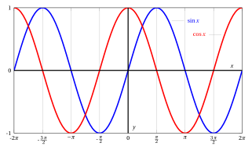
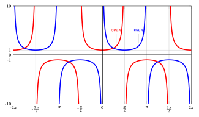
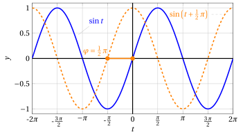
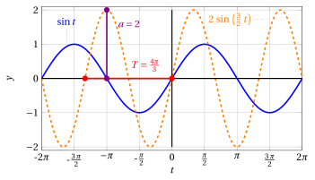
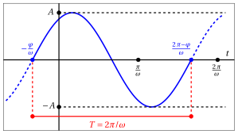
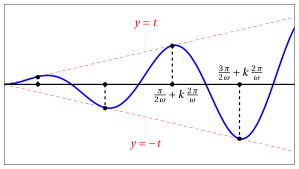
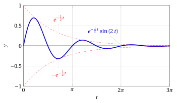

# Funzioni trigonometriche

**Parte 3 · Funzioni · Capitolo 6** · dalle dispense di Fabio Furini · [:material-file-pdf-box: Dispensa del volume (PDF)](../pdf/dispensa-3-funzioni.pdf) · [:material-presentation: Slide (PDF)](../pdf/slide-funzioni-05-trigonometriche.pdf)

## 1. Funzioni trigonometriche

!!! definizione "Definizione 1: funzione seno e funzione coseno"

    Le funzioni trigonometriche:

    \begin{align}
    \label{seno}  f: \mathbb{R} \rightarrow \mathbb{R},~~~ f: x \mapsto \sin x \\[2ex] 
     \label{coseno}
    f: \mathbb{R} \rightarrow \mathbb{R},~~~ f: x \mapsto \cos x
    \end{align}

    si chiamano <strong>seno</strong> e <strong>coseno</strong>.

- Il seno è una funzione <strong>dispari</strong> mentre il coseno è una funzione <strong>pari</strong>. Abbiamo quindi:

    $$
    \sin(-x)=-\sin x, ~~~\forall x \in \R {\rm ~~~~e~~~~} \cos(-x)=\cos x, ~~~\forall x \in \R
    $$

- Il seno e il coseno sono funzioni periodiche di periodo:

    $$
    T=2\: \pi {\rm ~~~~e~abbiamo~la~relazione~fondamentale~~~} \sin^2 x + \cos^2 x = 1,~~ \forall x \in \mathbb{R}
    $$

    { .fig .ovale loading=lazy style="width:80%" }

    Abbiamo

    $$
    \cos\left(x -\frac{\pi}{2}\right) = \sin x,~~ \forall x \in \mathbb{R}
    $$

- Per la positività e monotonicità della funzione seno abbiamo:

    $$
    \sin x = 0 \Longleftrightarrow x= k\;\pi,~ \forall k \in \Z \qquad 
    \begin{cases}
    \sin x > 0 & {\rm se~~~}  x \in (2\;k\;\pi~,~ 2\;k\;\pi + \pi),~ \forall k \in \Z    \\[3ex]
    \sin x < 0 & {\rm se~~~}  x \in (2\;k\;\pi-\pi~,~ 2\;k\;\pi),~ \forall k \in \Z    
    \end{cases}
    $$

    $$
    \begin{cases}
    {\rm se~~~}  x \in (2\;k\;\pi- \frac{\pi}{2},~ 2\;k\;\pi + \frac{\pi}{2}),~ \forall k \in \Z   & f {\rm ~~è~crescente}  \\[3ex]
    {\rm se~~~}  x \in (2\;k\;\pi+ \frac{\pi}{2}~,~ 2\;k\;\pi + \frac{3\;\pi}{2}),~ \forall k \in \Z   & f {\rm ~~è~decrescente}    
    \end{cases}
    $$

- Per la positività e monotonicità della funzione coseno abbiamo:

    $$
    \cos x = 0 \Longleftrightarrow x= k\;\pi-\frac{\pi}{2},~ \forall k \in \Z \qquad 
    \begin{cases}
    \cos x > 0 & {\rm se~~~}  x \in (2\;k\;\pi~-\frac{\pi}{2},~ 2\;k\;\pi + \frac{\pi}{2}),~ \forall k \in \Z    \\[3ex]
    \cos x < 0 & {\rm se~~~}  x \in (2\;k\;\pi+\frac{\pi}{2}~,~ 2\;k\;\pi +\frac{3\;\pi}{2}),~ \forall k \in \Z    
    \end{cases}
    $$

    $$
    \begin{cases}
    {\rm se~~~}  x \in (2\;k\;\pi+ \pi,~ 2\;k\;\pi + 2\; \pi),~ \forall k \in \Z   & f {\rm ~~è~crescente}  \\[3ex]
    {\rm se~~~}  x \in (2\;k\;\pi ~,~ 2\;k\;\pi + \pi),~ \forall k \in \Z   & f {\rm ~~è~decrescente}    
    \end{cases}
    $$

!!! chiave ""

    Le funzioni  trigonometriche:

    \begin{align}
    \label{tangente} f: \mathbb{R} \setminus \{k\;\pi-\frac{\pi}{2},~ \forall k \in \Z\}  \rightarrow \mathbb{R},~~~ f: x \mapsto \tan x = \frac{\sin x}{\cos x} \\[2ex] 
     \label{cotangente}
    f: \mathbb{R}\setminus \{k\;\pi,~ \forall k \in \Z\}  \rightarrow \mathbb{R},~~~ f: x \mapsto \cot x = \frac{\cos x}{\sin x}
    \end{align}

    si chiamano <strong>tangente</strong> e <strong>cotangente</strong> e sono entrambe dispari e periodiche di periodo $T=\pi$.

{ .fig .ovale loading=lazy style="width:60%" }

{ .fig .ovale loading=lazy style="width:80%" }

!!! chiave ""

    Le funzioni  trigonometriche:

    \begin{align}
    \label{secante} f: \mathbb{R} \setminus \{k\;\pi-\frac{\pi}{2},~ \forall k \in \Z\}  \rightarrow \mathbb{R},~~~ f: x \mapsto \sec x = \frac{1}{\cos x} \\[2ex] 
     \label{cosecante}
    f: \mathbb{R}\setminus \{k\;\pi,~ \forall k \in \Z\}  \rightarrow \mathbb{R},~~~ f: x \mapsto \csc x = \frac{1}{\sin x}
    \end{align}

    si chiamano <strong>secante</strong> e <strong>cosecante</strong> e sono periodiche di periodo $T=2\;\pi$. La funzione secante è pari mentre la funzione cosecante è dispari.

{ .fig .ovale loading=lazy style="width:80%" }

## 2. Valori delle funzioni trigonometriche

<table>
<tr>
<td></td>
<td>\(\cos\)</td>
<td>\(\sin\)</td>
<td>\(\tan\)</td>
<td>\(\cot\)</td>
<td>\(\sec\)</td>
<td>\(\csc\)</td>
</tr>
<tr>
<td>0</td>
<td>1</td>
<td>0</td>
<td>0</td>
<td>\(\pm \infty\)</td>
<td>1</td>
<td>\(\pm \infty\)</td>
</tr>
<tr>
<td>\(x=\frac{\pi}{6}\) (\(30^{\circ}\))</td>
<td>\(\frac{\sqrt{3}}{2}\)</td>
<td>\(\frac{1}{2}\)</td>
<td>\(\frac{\sqrt{3}}{3}\)</td>
<td>\(\sqrt{3}\)</td>
<td>\(\frac{2}{3}\:\sqrt{3}\)</td>
<td>2</td>
</tr>
<tr>
<td>\(x=\frac{\pi}{4}\) (\(45^{\circ}\))</td>
<td>\(\frac{\sqrt{2}}{2}\)</td>
<td>\(\frac{\sqrt{2}}{2}\)</td>
<td>1</td>
<td>1</td>
<td>\(\sqrt{2}\)</td>
<td>\(\sqrt{2}\)</td>
</tr>
<tr>
<td>\(x=\frac{\pi}{3}\) (\(60^{\circ}\))</td>
<td>\(\frac{1}{2}\)</td>
<td>\(\frac{\sqrt{3}}{2}\)</td>
<td>\(\sqrt{3}\)</td>
<td>\(\frac{\sqrt{3}}{3}\)</td>
<td>2</td>
<td>\(\frac{2}{3}\: \sqrt{3}\)</td>
</tr>
<tr>
<td>\(x=\frac{\pi}{2}\) (\(90^{\circ}\))</td>
<td>0</td>
<td>1</td>
<td>\(\pm \infty\)</td>
<td>0</td>
<td>\(\pm \infty\)</td>
<td>1</td>
</tr>
<tr>
<td>\(x=\pi\) (\(180^{\circ}\))</td>
<td>\-1</td>
<td>0</td>
<td>0</td>
<td>\(\pm \infty\)</td>
<td>\-1</td>
<td>\(\pm \infty\)</td>
</tr>
</table>

{ .fig .ovale loading=lazy style="width:68%" }

<table>
<tr>
<td></td>
<td>\(\phantom{-} \cos\)</td>
<td>\(\phantom{-} \sin\)</td>
<td>\(\phantom{-} \tan\)</td>
<td>\(\phantom{-} \cot\)</td>
</tr>
<tr>
<td>\(\phantom{-}x\)</td>
<td>\(\phantom{-} \cos x\)</td>
<td>\(\phantom{-} \sin x\)</td>
<td>\(\phantom{-} \tan x\)</td>
<td>\(\phantom{-} \cot x\)</td>
</tr>
<tr>
<td>\(-x\)</td>
<td>\(\phantom{-} \cos x\)</td>
<td>\(- \sin x\)</td>
<td>\(-\tan x\)</td>
<td>\(-\cot x\)</td>
</tr>
<tr>
<td>\(\frac{\pi}{2} +x\)</td>
<td>\(-\sin x\)</td>
<td>\(\phantom{-} \cos x\)</td>
<td>\(-\cot x\)</td>
<td>\(-\tan x\)</td>
</tr>
<tr>
<td>\(\frac{\pi}{2} - x\)</td>
<td>\(\phantom{-} \sin x\)</td>
<td>\(\phantom{-} \cos x\)</td>
<td>\(\phantom{-} \cot  x\)</td>
<td>\(\phantom{-} \tan x\)</td>
</tr>
<tr>
<td>\(\pi+x\)</td>
<td>\(-\cos x\)</td>
<td>\(-\sin x\)</td>
<td>\(\phantom{-} \tan x\)</td>
<td>\(\phantom{-} \cot x\)</td>
</tr>
<tr>
<td>\(\pi-x\)</td>
<td>\(-\cos x\)</td>
<td>\(\phantom{-} \sin x\)</td>
<td>\(-\tan x\)</td>
<td>\(-\cot x\)</td>
</tr>
</table>

## 3. Principali formule trigonometriche

<strong>Interdipendenze fra le funzioni trigonometriche</strong>

!!! chiave ""

    
<table>
    <tr>
    <td></td>
    <td>\(\sin x\)</td>
    <td>\(\cos x\)</td>
    <td>\(\tan x\)</td>
    <td>\(\cot x\)</td>
    </tr>
    <tr>
    <td>\(\sin x\)</td>
    <td>\-</td>
    <td>\(\pm \sqrt{1 - \cos^2 x}\)</td>
    <td>\(\pm \sqrt{\frac{\tan^2 x}{1 + \tan^2 x}}\)</td>
    <td>\(\pm \sqrt{\frac{1}{1 + \cot^2 x}}\)</td>
    </tr>
    <tr>
    <td>\(\cos x\)</td>
    <td>\(\pm \sqrt{1 - \sin^2 x}\)</td>
    <td>\-</td>
    <td>\(\pm \sqrt{\frac{1}{1 + \tan^2 x}}\)</td>
    <td>\(\pm \sqrt{\frac{\cot^2 x}{1 + \cot^2 x}}\)</td>
    </tr>
    <tr>
    <td>\(\tan x\)</td>
    <td>\(\pm\sqrt{\frac{\sin^2 x}{1 - \sin^2 x}}\)</td>
    <td>\(\pm\sqrt{\frac{1- \cos^2 x}{\cos^2 x}}\)</td>
    <td>\-</td>
    <td>\(\frac{1}{\cot x}\)</td>
    </tr>
    <tr>
    <td>\(\cot x\)</td>
    <td>\(\pm\sqrt{\frac{1- \sin^2 x}{\sin^2 x}}\)</td>
    <td>\(\pm\sqrt{\frac{\cos^2 x}{1 - \cos^2 x}}\)</td>
    <td>\(\frac{1}{\tan x}\)</td>
    <td>\-</td>
    </tr>
    </table>

    Dove il simbolo $\pm$ significa che il segno dipende dal quadrante in cui si trova $x$

<strong>Addizione e sottrazione</strong>

!!! chiave ""

    \begin{align}
    \label{trig:add}
    \sin ( x_1 \pm x_2)  &= \sin x_1 \: \cos x_2 \pm \sin x_2 \: \cos x_1\\[2ex]
    \cos ( x_1 \pm x_2)  &= \cos x_1 \: \cos x_2 \mp \sin x_1 \: \sin x_2
    \end{align}

!!! chiave ""

    \begin{align}
    \tan ( x_1 \pm x_2)  &= \frac{\tan x_1 \pm \tan x_2}{1 \mp \tan x_1 \: \tan x_2}\\[2ex]
    \cot ( x_1 \pm x_2)  &= \frac{\cot x_1 \: \cot x_2 \mp 1}{\cot x_2 \pm \cot x_1}
    \end{align}

<strong>Duplicazione</strong>

!!! chiave ""

    \begin{align}
    \sin ( 2\: x)  &= 2\: \sin x \: \cos x \\[2ex]
    \cos ( 2\: x)  &= \cos^2 x - \sin^2 x \nonumber\\[2ex]
                        &= 2\: \cos^2 x - 1 \nonumber\\[2ex]
                        &= 1 - 2\: \sin^2 x
    \end{align}

!!! chiave ""

    \begin{align}
    \tan ( 2\: x)  &= \frac{2 \:\tan x}{1 - \tan^2 x}\\[2ex]
    \cot ( 2\: x)  &= \frac{\cot^2 x -1}{2\: \cot x}
    \end{align}

<strong>Triplicazione</strong>

!!! chiave ""

    \begin{align}
    \sin ( 3\: x)  &= 3\: \sin x - 4\: \sin^3 x \\[2ex]
    \cos ( 3\: x)  &= 4\: \cos^3 x - 3\: \cos x
    \end{align}

<strong>Bisezione</strong>

!!! chiave ""

    \begin{align}
    \sin  \frac{x}{2}  &= \pm \sqrt{\frac{1 - \cos x}{2}}\\[2ex]
    \cos  \frac{x}{2}  &= \pm \sqrt{\frac{1 + \cos x}{2}}
    \end{align}

!!! chiave ""

    \begin{align}
    \tan  \frac{x}{2}  &= \pm \sqrt{\frac{1 - \cos x}{1 + \cos x}} \nonumber\\[2ex]
        &= \frac{\sin x}{1 + \cos x} \nonumber\\[2ex]
        &= \frac{1 - \cos x}{\sin x}
    \end{align}

!!! chiave ""

    \begin{align}
    \cot  \frac{x}{2}  &= \pm \sqrt{\frac{1 + \cos x}{1 - \cos x}} \nonumber\\[2ex]
        &= \frac{\sin x}{1 - \cos x} \nonumber\\[2ex]
        &= \frac{1 + \cos x}{\sin x}
    \end{align}

<strong>Formule parametriche</strong>

!!! chiave ""

    \begin{align}
    \sin {x}  &= \frac{2\: \tan \frac{{x}}{2}}{1+ \tan^2 \frac{{x}}{2}}\\[2ex]
    \cos {x}  &= \frac{1- \tan^2 \frac{{x}}{2}}{1+ \tan^2 \frac{{x}}{2}}
    \end{align}

<strong>Formule di prostaferesi</strong>

!!! chiave ""

    \begin{align}
    \sin  {x_1} + \sin {x_2}  &= \phantom{-} 2\: \sin \frac{x_1 + x_2}{2} \: \cos \frac{x_1 - x_2}{2}\\[2ex]
    \sin  {x_1} - \sin {x_2}  &= \phantom{-}2\: \sin \frac{x_1 - x_2}{2} \: \cos \frac{x_1 + x_2}{2}\\[2ex]
    \cos  {x_1} + \cos {x_2}  &= \phantom{-}2\: \cos \frac{x_1 + x_2}{2} \: \cos \frac{x_1 - x_2}{2}\\[2ex]
    \cos  {x_1} - \cos {x_2}  &= - 2\: \sin \frac{x_1 + x_2}{2} \: \sin \frac{x_1 - x_2}{2}
    \end{align}

<strong>Formule di Werner</strong>

!!! chiave ""

    \begin{align}
    \sin  {x_1} \: \sin {x_2}  &= \frac{1}{2} \bigg(\cos(x_1-x_2) - \cos(x_1 +x_2) \bigg)\\[2ex]
    \sin  {x_1} \: \cos {x_2}  &= \frac{1}{2} \bigg(\sin(x_1-x_2) + \sin(x_1 +x_2) \bigg)\\[2ex]
    \cos  {x_1} \: \cos {x_2}  &= \frac{1}{2} \bigg(\cos(x_1-x_2) + \cos(x_1 +x_2) \bigg)
    \end{align}

<strong>Formule aggiuntive</strong>

!!! chiave ""

    \begin{align}
    \sin^2 x  &= \frac{1 - \cos (2\:x)}{2}\\[2ex]
    \cos^2 x  &= \frac{1 + \cos (2\:x)}{2}\\[2ex]
    \sin  x \:\cos x  &= \frac{\sin (2\:x)}{2}
    \end{align}

## 4. Un'applicazione: i fenomeni vibratori

Le funzioni seno e coseno sono periodiche: per questo sono lo strumento naturale per descrivere i fenomeni che si ripetono nel tempo. In questa sezione le applichiamo ai <strong>fenomeni vibratori</strong>.

### 4.1 Fenomeni vibratori

- Abbiamo visto che le funzioni seno e coseno sono periodiche di <strong>periodo</strong> $2\: \pi$. Useremo la variabile $t$ per indicare il tempo.

    { .fig .ovale loading=lazy style="width:80%" }

- Ricordiamo che $\sin (t + \varphi)$ corrisponde a una <strong>transizione di fase</strong> $\varphi$ (traslazione orizzontale).

    { .fig .ovale loading=lazy style="width:80%" }

!!! chiave ""

    Le funzioni:

    \begin{equation}
    \label{trig_vibr}
    t \mapsto a\: \sin \:(\omega \: t), \qquad\qquad t \mapsto b\: \cos \:(\omega \: t)
    \end{equation}

    dove $a$, $b$ e $\omega$ sono numeri reali positivi, sono chiamate <strong>vibrazioni elementari</strong>.  Sono funzioni periodiche di

    $$
    {\rm \textbf{periodo}~~~} T = \frac{2\:\pi}{\omega}
    $$

!!! esempio "Esempio 1: periodo"

    Per esempio considerando $t' = t + \frac{2\: \pi}{\omega}$:

    $$
    \sin \left[ \omega \underbrace{\left( t + \frac{2\: \pi}{\omega} \right)}_{t'}\right] = \sin (\omega \: t + 2\: \pi) = \sin (\omega \: t)
    $$

- Chiaramente abbiamo:

    $$
    |a\: \sin \:(\omega \: t)| \le a \qquad{\rm ~~e~~}\qquad |b\: \cos \:(\omega \: t)| \le b
    $$

!!! chiave ""

    Le funzioni \(\eqref{trig_vibr}\) descrivono vibrazioni elementari caratterizzate da

    $$
    {\rm \textbf{ampiezza}~~} a {\rm ~~e~~} b {\rm ~~~~(rispettivamente)}
    $$

    $$
    {\rm \textbf{pulsazione}~~} \omega = \frac{2\: \pi}{T}
    $$

    detta anche <em>velocità angolare</em>, che  indica quanti periodi ci sono in un intervallo di $2\: \pi$. Inoltre sono caratterizzate dalla

    $$
    {\rm \textbf{frequenza}~~} \nu = \frac{\omega}{2\:\pi}
    $$

    che indica quante volte la funzione si ripete in un intervallo di lunghezza $1$

!!! esempio "Esempio 2: di ampiezza, pulsazione e frequenza"

    $$
    t \mapsto 2\: \sin \:\left( \frac{3}{2} \: t \right) \qquad a=2,~ \omega=\frac{3}{2},~ T=\frac{4\:\pi}{3}
    $$

    { .fig .ovale loading=lazy style="width:80%" }

    La pulsazione $\omega=\frac{3}{2}$ significa che ci sono 1.5 periodi nell'intervallo $2 \: \pi$. La frequenza $\nu$ è $\frac{3}{4\:\pi}$.

- La funzione

    \begin{equation}
    \label{EEE}
    h(t) = a\: \sin \:(\omega \: t) + b\: \cos \:(\omega \: t)
    \end{equation}

    descrive la <strong>sovrapposizione</strong> delle due vibrazioni elementari di <strong>uguale pulsazione</strong> $\omega$. Quest'ultima è ancora una vibrazione elementare <strong>sfasata</strong> rispetto alle precedenti.

- Infatti, posto

    $$
    A= \sqrt{a^2 + b^2}
    $$

    si può scrivere

    \begin{equation}
    \label{EEEE}
    h(t) = A \: \underbrace{\frac{a}{ \sqrt{a^2 + b^2}}}_{\alpha} \: \sin \:(\omega \: t) + A \: \underbrace{\frac{b}{ \sqrt{a^2 + b^2}}}_{\beta} \: \cos \:(\omega \: t)
    \end{equation}

- Osserviamo ora che i numeri

    $$
    \alpha=\frac{a}{ \sqrt{a^2 + b^2}} {\rm ~~e~~} \beta=\frac{b}{ \sqrt{a^2 + b^2}}
    $$

    soddisfano le condizioni

    $$
    -1 \le \alpha \le 1 \qquad -1 \le \beta \le 1 \qquad  \alpha^2 + \beta^2=1
    $$

    Esiste quindi un <strong>unico angolo</strong> $\varphi$ tale che

    $$
    \cos \varphi = \alpha \qquad \sin \varphi = \beta
    $$

    cosicché la \(\eqref{EEEE}\) si può riscrivere nella forma seguente

    \begin{align}
    \label{EEEEE}
    h(t) & = A \: \cos \varphi \: \sin (\omega \:t) + A \: \sin \varphi \: \cos (\omega \:t)\nonumber\\[2ex]
         & = A \: \sin (\omega\:t + \varphi)
    \end{align}

    Dunque $h(t)$ rappresenta una vibrazione elementare di ampiezza $A$, pulsazione $\omega$, sfasata di un angolo $\varphi$.

    { .fig .ovale loading=lazy style="width:80%" }

In sintesi:

!!! chiave ""

    \begin{align*}
    a\: \sin \:(\omega \: t) + b\: \cos \:(\omega \: t) = A \: \sin (\omega\:t + \varphi)\\[2ex]
    A = \sqrt{a^2 + b^2} \qquad 
    \begin{cases}
    a= A \: \cos \varphi \\
    b= A \: \sin \varphi 
    \end{cases}
    \end{align*}

- Sotto condizioni abbastanza generali; un fenomeno naturale periodico si potrà scrivere come sovrapposizione di un numero finito o infinito di vibrazioni elementari di frequenza diversa (<strong>serie di Fourier</strong>).

<strong>Prova tu</strong> — il grafico interattivo qui sotto ti fa vedere quello che hai appena letto: muovi i cursori.

### 4.2 Effetti di smorzamento o di amplificazione

- Moltiplicando una vibrazione elementare per <strong>potenze</strong> o <strong>esponenziali</strong> si possono modellizzare effetti di <strong>smorzamento</strong> o di <strong>amplificazione</strong>.

<strong>Primo esempio</strong>

- Per esempio, consideriamo la funzione

    $$
    h(t) = t \: \sin \:(\omega \: t)
    $$

    modellizza una <strong>vibrazione amplificata</strong>.

- Essendo $-1 \le \sin \:(\omega \: t) \le 1$  si ha

    $$
    -t \le t \: \sin \:(\omega \: t) \le t
    $$

    e quindi il grafico di $h(t)$ si trova tra i grafici delle rette di equazione $y = -t$, $y = t$.

- Nei punti in cui

    $$
    \sin \:(\omega\:t) = 1
    $$

    cioè

    $$
    t = \frac{\pi}{2 \: \omega} + k \: \frac{2\:\pi}{\omega} \qquad (k=0,1,2,\dots)
    $$

    il grafico di $h(t)$ tocca quello di $y=t$.

- Nei punti in cui

    $$
    \sin \:(\omega\:t) = -1
    $$

    cioè

    $$
    t = \frac{3\: \pi}{2 \: \omega} + k \: \frac{2\:\pi}{\omega} \qquad (k=0,1,2,\dots)
    $$

    il grafico di $h(t)$ tocca quello di $y=-t$.

    { .fig .ovale loading=lazy style="width:80%" }

- Dal grafico si vede come la moltiplicazione per $t$ abbia l'effetto di una moltiplicazione della vibrazione, all'aumentare di $t$.

{ .fig .ovale loading=lazy style="width:80%" }

{ .fig .ovale loading=lazy style="width:80%" }

<strong>Secondo esempio</strong>

- Per esempio, consideriamo la funzione

    $$
    k(t) = e^{-\alpha\:t} \: \sin \:(\omega \: t) \qquad (\alpha > 0)
    $$

    modellizza una <strong>vibrazione smorzata</strong>.

- Ricordando che

    $$
    e^{-\alpha\:t} = \left(\frac{1}{e^{\alpha}}\right)^t
    $$

    è un'esponenziale con base minore di $1$, considerazioni analoghe a quelle svolte per la funzione $h(t)$, indicano che il grafico di $k$ è compreso tra i grafici delle funzioni

    $$
    y_1 = e^{-\alpha\:t} {\rm ~~~~e~~~~} y_2 = -e^{-\alpha\:t}
    $$

    come in figura:

{ .fig .ovale loading=lazy style="width:80%" }

{ .fig .ovale loading=lazy style="width:80%" }
