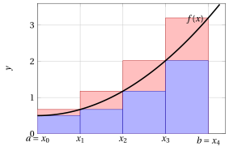
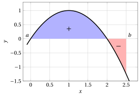
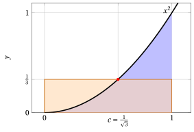

# L'integrale di Riemann

**Parte 7 · Integrali · Capitolo 1** · [:material-file-pdf-box: Dispensa, volume 7 (PDF)](../pdf/dispensa-7-integrali.pdf) · [:material-pencil-box-multiple: Esercizi, volume 7 (PDF)](../pdf/esercizi-7-integrali.pdf) · [:material-pencil: Esercizi: Integrale di Riemann e proprietà](../esercizi/es-integrali-03-integrale-riemann.md) · [:material-presentation: Slide (PDF)](../pdf/slide-integrali-01-integrale-riemann.pdf) · [:material-gesture-tap: App: Somme di Riemann](../interattivi/somme-di-riemann.md)

!!! nota "Prerequisiti"

    - Dal capitolo [«Campi ordinati, estremo superiore/inferiore e assioma di continuità»](https://fabiofurini.github.io/analisi-matematica-1/numeri/03-campi-ordinati/): estremo superiore e inferiore di un insieme e loro esistenza in $\R$.

    - Dal capitolo [«Sommatorie, progressioni geometriche e aritmetiche»](https://fabiofurini.github.io/analisi-matematica-1/numeri/05-sommatorie/): il simbolo di sommatoria e la somma dei primi $n$ numeri naturali.

    - Dai capitoli [«Funzioni continue»](https://fabiofurini.github.io/analisi-matematica-1/limiti/04-funzioni-continue/) e [«Teorema di Weierstrass e teorema dei valori intermedi»](https://fabiofurini.github.io/analisi-matematica-1/limiti/09-weierstrass/): continuità, massimo e minimo su un intervallo chiuso e limitato, valori intermedi.

!!! chiave "Obiettivi"

    Alla fine di questo capitolo sarai in grado di:

    - calcolare le somme inferiori e superiori di una funzione limitata rispetto a una partizione;

    - enunciare la definizione di integrale di Riemann e interpretarlo come area con segno;

    - dimostrare che le funzioni monotone e le funzioni continue su $[a,b]$ sono integrabili;

    - usare linearità, additività, monotonia e la disuguaglianza $\left|\int_a^b f\right| \le \int_a^b |f|$;

    - enunciare e dimostrare il teorema della media integrale.

## 1. Partizioni e somme di Riemann

!!! definizione "Definizione 1: di partizione di un intervallo"

    Dato un intervallo $[a,b]$, con $a<b$, si chiama <strong>partizione</strong> di $[a,b]$ un insieme finito di punti

    $$
    P = \{x_0, x_1, \dots, x_n\} {\rm ~~~con~~~} a = x_0 < x_1 < \dots < x_n = b
    $$

    I punti $x_k$ dividono $[a,b]$ negli $n$ intervalli $I_k = [x_{k-1}, x_k]$, con $k \in \{1, 2, \dots, n\}$, di ampiezza $\Delta x_k = x_k - x_{k-1}$.

- La partizione si dice <strong>uniforme</strong> quando tutti gli intervalli hanno la stessa ampiezza $\Delta x_k = \frac{b-a}{n}$, ovvero quando $x_k = a + k\,\frac{b-a}{n}$.

- Se $P \subseteq P'$, la partizione $P'$ si dice <strong>più fine</strong> di $P$ (o un <strong>raffinamento</strong> di $P$): si ottiene da $P$ aggiungendo punti.

!!! definizione "Definizione 2: di somma inferiore e di somma superiore"

    Sia $f:[a,b] \rr \R$ una funzione limitata e sia $P = \{x_0, x_1, \dots, x_n\}$ una partizione di $[a,b]$. Posto, per ogni $k \in \{1, 2, \dots, n\}$,

    $$
    m_k = \inf_{x \in I_k} f(x) {\rm ~~~~e~~~~} M_k = \sup_{x \in I_k} f(x)
    $$

    si chiamano <strong>somma inferiore</strong> e <strong>somma superiore</strong> di $f$ relative a $P$ i numeri

    $$
    s(f,P) = \sum_{k=1}^{n} m_k \, \Delta x_k {\rm ~~~~e~~~~} S(f,P) = \sum_{k=1}^{n} M_k \, \Delta x_k
    $$

- Gli estremi $m_k$ e $M_k$ sono numeri reali perché $f$ è limitata. Dato che $m_k \le M_k$ per ogni $k$, si ha sempre $s(f,P) \le S(f,P)$.

- Se $f \ge 0$, la somma inferiore è l'area dei rettangoli <strong>inscritti</strong> nella regione sotto il grafico, la somma superiore quella dei rettangoli <strong>circoscritti</strong>.

{ .fig .ovale loading=lazy style="width:65%" }

- Nella figura, con $f$ crescente, i rettangoli blu formano la somma inferiore e i rettangoli blu insieme ai rossi la somma superiore: l'area sotto il grafico sta in mezzo.

!!! esempio "Esempio 1: somme inferiori e superiori di $f(x)=x$"

    Sia $f(x) = x$ in $[0,1]$ e sia $P_n$ la partizione uniforme con $x_k = \frac{k}{n}$. Poiché $f$ è crescente, in ogni intervallo $I_k$ il minimo è nell'estremo sinistro e il massimo nell'estremo destro:

    $$
    m_k = \frac{k-1}{n}, ~~~~~ M_k = \frac{k}{n}, ~~~~~ \Delta x_k = \frac{1}{n}
    $$

    Con la somma dei primi $n$ numeri naturali, $\sum_{k=1}^{n} k = \frac{n(n+1)}{2}$, otteniamo

    $$
    S(f,P_n) = \frac{1}{n^2}\sum_{k=1}^{n} k = \frac{n+1}{2n}, ~~~~~~ s(f,P_n) = \frac{1}{n^2}\sum_{k=1}^{n} (k-1) = \frac{n-1}{2n}
    $$

    La differenza $S(f,P_n) - s(f,P_n) = \frac{1}{n}$ tende a $0$ e le due somme tendono a $\frac12$.

!!! teorema "Proposizione 1: delle somme e dei raffinamenti"

    Sia $f:[a,b] \rr \R$ limitata. Se $P'$ è più fine di $P$, allora

    $$
    s(f,P) \le s(f,P') \le S(f,P') \le S(f,P)
    $$

??? dimostrazione "Dimostrazione"

    Basta considerare il caso in cui $P'$ ha un solo punto in più, $y \in (x_{k-1}, x_k)$: il caso generale si ottiene aggiungendo un punto alla volta. Le due somme differiscono solo per l'intervallo $I_k$, che in $P'$ è diviso in $[x_{k-1}, y]$ e $[y, x_k]$.

    L'estremo inferiore su un sottoinsieme è maggiore o uguale a quello sull'insieme intero, quindi

    $$
    m' = \inf_{[x_{k-1},y]} f \ge m_k {\rm ~~~~e~~~~} m'' = \inf_{[y,x_k]} f \ge m_k
    $$

    Di conseguenza

    $$
    m'\,(y - x_{k-1}) + m''\,(x_k - y) \ge m_k\,(y - x_{k-1}) + m_k\,(x_k - y) = m_k \, \Delta x_k
    $$

    cioè $s(f,P') \ge s(f,P)$. Per le somme superiori si ragiona allo stesso modo con gli estremi superiori, che su un sottoinsieme sono minori o uguali: $S(f,P') \le S(f,P)$. □

!!! teorema "Corollario 1"

    Sia $f:[a,b] \rr \R$ limitata. Per ogni coppia di partizioni $P_1$ e $P_2$ di $[a,b]$ si ha

    $$
    s(f,P_1) \le S(f,P_2)
    $$

??? dimostrazione "Dimostrazione"

    La partizione $P = P_1 \cup P_2$ è più fine sia di $P_1$ sia di $P_2$. Per la Proposizione delle somme e dei raffinamenti

    $$
    s(f,P_1) \le s(f,P) \le S(f,P) \le S(f,P_2)
    $$

    
□

- Ogni somma superiore è quindi un maggiorante dell'insieme delle somme inferiori. Per l'assioma di continuità esistono finiti

    $$
    \sup_{P} s(f,P) ~~\le~~ \inf_{P} S(f,P)
    $$

    dove estremo superiore e inferiore sono presi al variare di tutte le partizioni $P$ di $[a,b]$.

## 2. L'integrale di Riemann

!!! definizione "Definizione 3: di funzione integrabile secondo Riemann"

    Una funzione limitata $f:[a,b] \rr \R$ si dice <strong>integrabile secondo Riemann</strong> in $[a,b]$ se

    $$
    \sup_{P} s(f,P) = \inf_{P} S(f,P)
    $$

    Il valore comune si chiama <strong>integrale</strong> di $f$ in $[a,b]$ e si indica con

    $$
    \int_a^b f(x) \, dx
    $$

- La funzione $f$ si dice <strong>funzione integranda</strong>, i numeri $a$ e $b$ sono gli <strong>estremi di integrazione</strong>.

- La variabile $x$ è <strong>muta</strong>: $\int_a^b f(x)\,dx$, $\int_a^b f(t)\,dt$ e $\int_a^b f(u)\,du$ indicano lo stesso numero.

- Il simbolo $\int$ è una $S$ allungata (somma) e $dx$ ricorda le ampiezze $\Delta x_k$ dei rettangoli.

### 2.1 Interpretazione geometrica

- Se $f \ge 0$ in $[a,b]$, l'integrale è l'<strong>area del trapezoide</strong> (o sottografico)

    $$
    T_f = \big\{ (x,y) \in \R^2 : a \le x \le b, ~ 0 \le y \le f(x) \big\}
    $$

    che è compreso fra i plurirettangoli inscritti (somme inferiori) e circoscritti (somme superiori).

- Se $f$ cambia segno, le parti sotto l'asse $x$ contano con il segno meno: l'integrale è un'<strong>area con segno</strong>, cioè l'area sopra l'asse meno l'area sotto l'asse.

{ .fig .ovale loading=lazy style="width:65%" }

- Nella figura l'integrale di $f$ in $[a,b]$ è l'area blu meno l'area rossa.

!!! esempio "Esempio 2: integrale di una costante"

    Sia $f(x) = c$ in $[a,b]$, con $c \in \R$. Per ogni partizione $P$ si ha $m_k = M_k = c$, quindi

    $$
    s(f,P) = S(f,P) = \sum_{k=1}^{n} c \, \Delta x_k = c\,(b-a)
    $$

    La funzione costante è integrabile e

    $$
    \int_a^b c \, dx = c\,(b-a)
    $$

    Se $c>0$ è l'area del rettangolo di base $b-a$ e altezza $c$.

!!! esempio "Esempio 3: integrale di $f(x)=x$"

    Riprendiamo $f(x) = x$ in $[0,1]$ e le partizioni uniformi $P_n$ dell'Esempio sulle somme inferiori e superiori di $f(x)=x$. Per ogni $n$

    $$
    \frac{n-1}{2n} = s(f,P_n) \le \sup_{P} s(f,P) \le \inf_{P} S(f,P) \le S(f,P_n) = \frac{n+1}{2n}
    $$

    Passando al limite per $n \rr \ip$ i due estremi tendono a $\frac12$, quindi

    $$
    \sup_{P} s(f,P) = \inf_{P} S(f,P) = \frac12 {\rm ~~~~ovvero~~~~} \int_0^1 x \, dx = \frac12
    $$

    È l'area del triangolo di vertici $(0,0)$, $(1,0)$ e $(1,1)$.

!!! esempio "Esempio 4: integrale di $f(x)=x^2$"

    Sia $f(x) = x^2$ in $[0,1]$ e $P_n$ la partizione uniforme. La funzione è crescente in $[0,1]$, quindi $m_k = \left(\frac{k-1}{n}\right)^2$ e $M_k = \left(\frac{k}{n}\right)^2$. Usando la formula $\sum_{k=1}^{n} k^2 = \frac{n(n+1)(2n+1)}{6}$ (si dimostra per induzione) otteniamo

    $$
    S(f,P_n) = \frac{1}{n^3}\sum_{k=1}^{n} k^2 = \frac{(n+1)(2n+1)}{6n^2}, ~~~~~~ s(f,P_n) = \frac{1}{n^3}\sum_{k=1}^{n-1} k^2 = \frac{(n-1)(2n-1)}{6n^2}
    $$

    Entrambe tendono a $\frac{2}{6} = \frac13$ per $n \rr \ip$; ragionando come nell'esempio precedente

    $$
    \int_0^1 x^2 \, dx = \frac13
    $$

!!! esempio "Esempio 5: una funzione non integrabile"

    La <strong>funzione di Dirichlet</strong> in $[0,1]$ è

    $$
    D(x) = \begin{cases} 1 & {\rm se~} x \in \Q \\ 0 & {\rm se~} x \notin \Q \end{cases}
    $$

    Ogni intervallo $I_k$ contiene sia numeri razionali sia numeri irrazionali (densità di $\Q$ e di $\R \setminus \Q$ in $\R$), quindi $m_k = 0$ e $M_k = 1$ per ogni $k$. Per ogni partizione

    $$
    s(D,P) = 0 {\rm ~~~~e~~~~} S(D,P) = \sum_{k=1}^{n} \Delta x_k = 1
    $$

    Dunque $\sup_P s(D,P) = 0 \neq 1 = \inf_P S(D,P)$: la funzione di Dirichlet è limitata ma <strong>non</strong> è integrabile secondo Riemann.

### 2.2 Criterio di integrabilità

!!! teorema "Teorema 1: criterio di integrabilità di Riemann"

    Una funzione limitata $f:[a,b] \rr \R$ è integrabile in $[a,b]$ se e solo se per ogni $\varepsilon > 0$ esiste una partizione $P$ di $[a,b]$ tale che

    $$
    S(f,P) - s(f,P) < \varepsilon
    $$

??? dimostrazione "Dimostrazione"

    Poniamo $I_- = \sup_P s(f,P)$ e $I^+ = \inf_P S(f,P)$; sappiamo che $I_- \le I^+$.

    - <strong>($\Leftarrow$)</strong> Per ogni $\varepsilon > 0$ esiste $P$ con $s(f,P) \le I_- \le I^+ \le S(f,P)$ e $S(f,P) - s(f,P) < \varepsilon$. Quindi $0 \le I^+ - I_- < \varepsilon$ per ogni $\varepsilon > 0$, cioè $I^+ = I_-$.

    - <strong>($\Rightarrow$)</strong> Sia $I = I_- = I^+$ e sia $\varepsilon > 0$. Per le proprietà di estremo superiore e inferiore esistono $P_1$ e $P_2$ con

        $$
        s(f,P_1) > I - \frac{\varepsilon}{2} {\rm ~~~~e~~~~} S(f,P_2) < I + \frac{\varepsilon}{2}
        $$

        Con $P = P_1 \cup P_2$, per la Proposizione delle somme e dei raffinamenti, $S(f,P) - s(f,P) \le S(f,P_2) - s(f,P_1) < \varepsilon$.

    
□

### 2.3 Somme di Riemann

- Scelto in ogni intervallo $I_k$ un punto $t_k$, la somma $\sigma(f,P) = \sum_{k=1}^{n} f(t_k)\,\Delta x_k$ si chiama <strong>somma di Riemann</strong>.

- Poiché $m_k \le f(t_k) \le M_k$, si ha $s(f,P) \le \sigma(f,P) \le S(f,P)$: se $f$ è integrabile e $S(f,P) - s(f,P) \rr 0$, anche le somme di Riemann tendono all'integrale, qualunque sia la scelta dei punti $t_k$.

- Per le funzioni continue con partizioni uniformi, $t_k$ può essere l'estremo sinistro, l'estremo destro o il punto medio di $I_k$: è il modo in cui si approssima un integrale al calcolatore.

<strong>Prova tu</strong> — il grafico interattivo qui sotto ti fa vedere quello che hai appena letto: muovi i cursori.

## 3. Classi di funzioni integrabili

!!! teorema "Teorema 2: di integrabilità delle funzioni monotone"

    Se $f:[a,b] \rr \R$ è monotona, allora $f$ è integrabile in $[a,b]$.

??? dimostrazione "Dimostrazione"

    Supponiamo $f$ non decrescente (il caso non crescente è analogo). La funzione è limitata, perché $f(a) \le f(x) \le f(b)$. Sia $P_n$ la partizione uniforme, con $\Delta x_k = \frac{b-a}{n}$. In ogni intervallo $I_k$ si ha $m_k = f(x_{k-1})$ e $M_k = f(x_k)$, quindi

    $$
    S(f,P_n) - s(f,P_n) = \frac{b-a}{n} \sum_{k=1}^{n} \big( f(x_k) - f(x_{k-1}) \big) = \frac{(b-a)\,\big(f(b) - f(a)\big)}{n}
    $$

    perché la somma è telescopica. Dato $\varepsilon > 0$, basta prendere $n > \frac{(b-a)(f(b) - f(a))}{\varepsilon}$ per avere $S(f,P_n) - s(f,P_n) < \varepsilon$. Per il Criterio di integrabilità di Riemann, $f$ è integrabile. □

- Una funzione monotona può avere punti di discontinuità: per esempio la parte intera $[x]$ è integrabile in ogni intervallo $[a,b]$, anche se ha un salto in ogni numero intero.

### 3.1 Continuità uniforme

!!! definizione "Definizione 4: di funzione uniformemente continua"

    Una funzione $f: I \rr \R$ si dice <strong>uniformemente continua</strong> nell'intervallo $I$ se per ogni $\varepsilon > 0$ esiste $\delta > 0$ tale che

    $$
    x, y \in I, ~~ |x - y| < \delta ~~~\Longrightarrow~~~ |f(x) - f(y)| < \varepsilon
    $$

- Nella continuità in ogni punto il numero $\delta$ può dipendere dal punto; nella continuità uniforme lo stesso $\delta$ va bene per tutti i punti di $I$.

- Una funzione uniformemente continua in $I$ è continua in ogni punto di $I$.

!!! esempio "Esempio 6: continuità uniforme"

    La funzione $f(x) = x^2$ è uniformemente continua in $[0,1]$: per $x, y \in [0,1]$

    $$
    |x^2 - y^2| = |x+y|\,|x-y| \le 2\,|x - y|
    $$

    e basta scegliere $\delta = \frac{\varepsilon}{2}$.

    La funzione $g(x) = \frac{1}{x}$ è continua in $(0,1]$ ma non uniformemente continua: i punti $x_n = \frac1n$ e $y_n = \frac{1}{n+1}$ hanno distanza $\frac{1}{n(n+1)} \rr 0$, mentre $|g(x_n) - g(y_n)| = 1$ per ogni $n$.

!!! teorema "Teorema 3: di Heine–Cantor"

    Se $f:[a,b] \rr \R$ è continua nell'intervallo chiuso e limitato $[a,b]$, allora $f$ è uniformemente continua in $[a,b]$.

??? dimostrazione "Dimostrazione"

    Per assurdo: esiste $\varepsilon > 0$ tale che per ogni $n \ge 1$ ci sono $x_n, y_n \in [a,b]$ con

    $$
    |x_n - y_n| < \frac1n {\rm ~~~~e~~~~} |f(x_n) - f(y_n)| \ge \varepsilon
    $$

    La successione $\{x_n\}$ è limitata. Per il teorema di Bolzano–Weierstrass (ogni successione limitata ha una sottosuccessione convergente: si dimostra con la stessa bisezione usata per il Teorema di Weierstrass) esiste una sottosuccessione $x_{n_j} \rr c$, con $c \in [a,b]$ perché l'intervallo è chiuso.

    Poiché $|x_{n_j} - y_{n_j}| < \frac{1}{n_j}$, anche $y_{n_j} \rr c$. Per la continuità di $f$ in $c$

    $$
    f(x_{n_j}) - f(y_{n_j}) \rr f(c) - f(c) = 0
    $$

    in contraddizione con $|f(x_{n_j}) - f(y_{n_j})| \ge \varepsilon$ per ogni $j$. □

### 3.2 Integrabilità delle funzioni continue

!!! teorema "Teorema 4: di integrabilità delle funzioni continue"

    Se $f:[a,b] \rr \R$ è continua, allora $f$ è integrabile in $[a,b]$.

??? dimostrazione "Dimostrazione"

    Per il Teorema di Weierstrass $f$ è limitata. Sia $\varepsilon > 0$. Per il Teorema di Heine–Cantor esiste $\delta > 0$ tale che

    $$
    |x - y| < \delta ~~~\Longrightarrow~~~ |f(x) - f(y)| < \frac{\varepsilon}{b-a}
    $$

    Prendiamo una partizione $P$ con tutti gli intervalli di ampiezza $\Delta x_k < \delta$. In ogni $I_k$, per il Teorema di Weierstrass, $f$ ha minimo $m_k = f(\xi_k)$ e massimo $M_k = f(\eta_k)$, con $|\xi_k - \eta_k| \le \Delta x_k < \delta$. Quindi $M_k - m_k < \frac{\varepsilon}{b-a}$ e

    $$
    S(f,P) - s(f,P) = \sum_{k=1}^{n} (M_k - m_k)\,\Delta x_k < \frac{\varepsilon}{b-a} \sum_{k=1}^{n} \Delta x_k = \varepsilon
    $$

    Per il Criterio di integrabilità di Riemann, $f$ è integrabile. □

!!! osservazione "Osservazione 1"

    Si dimostra che è integrabile anche una funzione limitata in $[a,b]$ che è continua tranne che in un numero finito di punti. Inoltre, se si modifica una funzione integrabile in un numero finito di punti, si ottiene una funzione integrabile con lo stesso integrale.

## 4. Proprietà dell'integrale

- Conviene estendere il simbolo di integrale al caso in cui gli estremi sono uguali o scambiati:

    $$
    \int_a^a f(x)\,dx = 0 {\rm ~~~~e~~~~} \int_b^a f(x)\,dx = -\int_a^b f(x)\,dx
    $$

### 4.1 Linearità

!!! teorema "Teorema 5: di linearità dell'integrale"

    Se $f$ e $g$ sono integrabili in $[a,b]$ e $\alpha, \beta \in \R$, allora $\alpha f + \beta g$ è integrabile in $[a,b]$ e

    $$
    \int_a^b \big( \alpha f(x) + \beta g(x) \big)\, dx = \alpha \int_a^b f(x)\,dx + \beta \int_a^b g(x)\,dx
    $$

??? dimostrazione "Dimostrazione"

    Basta trattare separatamente la somma $f+g$ e il multiplo $\alpha f$.

    - <strong>Somma.</strong> In ogni intervallo $I_k$ si ha $\inf (f+g) \ge \inf f + \inf g$ e $\sup (f+g) \le \sup f + \sup g$, quindi

        $$
        s(f,P) + s(g,P) \le s(f+g,P) \le S(f+g,P) \le S(f,P) + S(g,P)
        $$

        Dato $\varepsilon > 0$, per il Criterio di integrabilità di Riemann e la Proposizione delle somme e dei raffinamenti esiste una partizione $P$ (unione di quelle che vanno bene per $f$ e per $g$) con $S - s < \frac{\varepsilon}{2}$ sia per $f$ sia per $g$. Allora $S(f+g,P) - s(f+g,P) < \varepsilon$ e $f+g$ è integrabile. Inoltre $\int (f+g)$ e $\int f + \int g$ stanno entrambi fra $s(f,P)+s(g,P)$ e $S(f,P)+S(g,P)$: distano meno di $\varepsilon$ per ogni $\varepsilon > 0$, quindi coincidono.

    - <strong>Multiplo.</strong> Se $\alpha \ge 0$, si ha $\inf (\alpha f) = \alpha \inf f$ e $\sup (\alpha f) = \alpha \sup f$, quindi $s(\alpha f, P) = \alpha\, s(f,P)$ e $S(\alpha f,P) = \alpha\, S(f,P)$. Se $\alpha < 0$, estremo inferiore e superiore si scambiano: $s(\alpha f,P) = \alpha\, S(f,P)$ e $S(\alpha f,P) = \alpha\, s(f,P)$. In entrambi i casi $\int \alpha f = \alpha \int f$.

    
□

### 4.2 Additività rispetto all'intervallo

!!! teorema "Teorema 6: di additività rispetto all'intervallo"

    Siano $a < c < b$. Una funzione $f$ è integrabile in $[a,b]$ se e solo se è integrabile in $[a,c]$ e in $[c,b]$, e in tal caso

    $$
    \int_a^b f(x)\,dx = \int_a^c f(x)\,dx + \int_c^b f(x)\,dx
    $$

??? dimostrazione "Dimostrazione"

    Per la Proposizione delle somme e dei raffinamenti possiamo usare solo partizioni $P$ di $[a,b]$ che contengono $c$ (aggiungere $c$ non peggiora la differenza $S - s$). Una tale $P$ è l'unione di una partizione $P_1$ di $[a,c]$ e di una partizione $P_2$ di $[c,b]$, e

    $$
    s(f,P) = s(f,P_1) + s(f,P_2), ~~~~~~ S(f,P) = S(f,P_1) + S(f,P_2)
    $$

    Quindi $S(f,P) - s(f,P)$ è la somma delle due differenze, entrambe non negative: è minore di $\varepsilon$ se e solo se lo sono (a meno di dimezzare $\varepsilon$) entrambe. Per il Criterio di integrabilità di Riemann le due integrabilità sono equivalenti. Infine $\int_a^b f$ e $\int_a^c f + \int_c^b f$ stanno entrambi fra $s(f,P)$ e $S(f,P)$, che distano meno di $\varepsilon$: coincidono. □

- Con la convenzione sugli estremi scambiati, la formula di additività vale per $a$, $b$, $c$ in qualunque ordine, purché $f$ sia integrabile nell'intervallo più grande.

!!! esempio "Esempio 7: additività"

    Sia $f(x) = x$ per $x \in [0,1]$ e $f(x) = 1$ per $x \in [1,3]$. La funzione è continua, quindi integrabile, e per l'additività

    $$
    \int_0^3 f(x)\,dx = \int_0^1 x \, dx + \int_1^3 1 \, dx = \frac12 + 2 = \frac52
    $$

    dove abbiamo usato l'Esempio sull'integrale di $f(x)=x$ e quello sull'integrale di una costante.

### 4.3 Monotonia e valore assoluto

!!! teorema "Teorema 7: di monotonia dell'integrale"

    Se $f$ e $g$ sono integrabili in $[a,b]$ e $f(x) \le g(x)$ per ogni $x \in [a,b]$, allora

    $$
    \int_a^b f(x)\,dx \le \int_a^b g(x)\,dx
    $$

??? dimostrazione "Dimostrazione"

    In ogni intervallo $I_k$ si ha $\inf f \le \inf g$, quindi $s(f,P) \le s(g,P) \le \int_a^b g$ per ogni partizione $P$. Passando all'estremo superiore su $P$, $\int_a^b f = \sup_P s(f,P) \le \int_a^b g$. □

!!! teorema "Corollario 2: stime dell'integrale"

    Sia $f$ integrabile in $[a,b]$.

    - Se $f(x) \ge 0$ per ogni $x \in [a,b]$, allora $\int_a^b f(x)\,dx \ge 0$.

    - Se $m \le f(x) \le M$ per ogni $x \in [a,b]$, allora

        $$
        m\,(b-a) \le \int_a^b f(x)\,dx \le M\,(b-a)
        $$

??? dimostrazione "Dimostrazione"

    Si applica il Teorema di monotonia dell'integrale confrontando $f$ con le costanti $0$, $m$ e $M$, il cui integrale è dato dall'Esempio sull'integrale di una costante. □

!!! esempio "Esempio 8: una stima senza calcolare l'integrale"

    In $[0,1]$ la funzione $f(x) = e^{-x^2}$ è decrescente, quindi $e^{-1} \le f(x) \le 1$. Per il Corollario delle stime dell'integrale

    $$
    \frac{1}{e} \le \int_0^1 e^{-x^2}\,dx \le 1
    $$

    pur senza conoscere una primitiva elementare di $e^{-x^2}$.

!!! teorema "Teorema 8: dell'integrale del valore assoluto"

    Se $f$ è integrabile in $[a,b]$, allora anche $|f|$ è integrabile in $[a,b]$ e

    $$
    \left| \int_a^b f(x)\,dx \right| \le \int_a^b |f(x)|\,dx
    $$

??? dimostrazione "Dimostrazione"

    - <strong>Integrabilità di $|f|$.</strong> Per $x, y \in I_k$ si ha $\big| |f(x)| - |f(y)| \big| \le |f(x) - f(y)| \le M_k - m_k$. Prendendo l'estremo superiore in $x$ e l'estremo inferiore in $y$, la differenza fra estremo superiore e inferiore di $|f|$ in $I_k$ è al più $M_k - m_k$. Quindi $S(|f|,P) - s(|f|,P) \le S(f,P) - s(f,P)$ e si conclude con il Criterio di integrabilità di Riemann.

    - <strong>Disuguaglianza.</strong> Da $-|f(x)| \le f(x) \le |f(x)|$, per il Teorema di linearità dell'integrale e il Teorema di monotonia dell'integrale,

        $$
        -\int_a^b |f(x)|\,dx \le \int_a^b f(x)\,dx \le \int_a^b |f(x)|\,dx
        $$

        che è la tesi.

    
□

!!! esempio "Esempio 9: la disuguaglianza può essere stretta"

    Sia $f(x) = x$ in $[-1,1]$. Le aree con segno dei due triangoli si compensano, mentre per $|x|$ si sommano:

    $$
    \int_{-1}^{1} x\,dx = -\frac12 + \frac12 = 0, ~~~~~~ \int_{-1}^{1} |x|\,dx = \frac12 + \frac12 = 1
    $$

    Quindi $\left|\int_{-1}^1 x\,dx\right| = 0 < 1 = \int_{-1}^1 |x|\,dx$.

## 5. Teorema della media integrale

!!! definizione "Definizione 5: di media integrale"

    Sia $f$ integrabile in $[a,b]$. Si chiama <strong>media integrale</strong> (o valor medio) di $f$ in $[a,b]$ il numero

    $$
    \frac{1}{b-a} \int_a^b f(x)\,dx
    $$

- Se $f \ge 0$, la media integrale è l'altezza del rettangolo di base $[a,b]$ che ha la stessa area del trapezoide di $f$.

!!! teorema "Teorema 9: della media integrale"

    Se $f:[a,b] \rr \R$ è continua, allora esiste $c \in [a,b]$ tale che

    $$
    f(c) = \frac{1}{b-a} \int_a^b f(x)\,dx
    $$

??? dimostrazione "Dimostrazione"

    Per il Teorema di Weierstrass $f$ ha minimo $m$ e massimo $M$ in $[a,b]$. Per il Corollario delle stime dell'integrale

    $$
    m\,(b-a) \le \int_a^b f(x)\,dx \le M\,(b-a) ~~~\Longrightarrow~~~ m \le \frac{1}{b-a}\int_a^b f(x)\,dx \le M
    $$

    La media integrale è quindi un valore compreso fra il minimo e il massimo di $f$. Per il Teorema dei valori intermedi $f$ assume tutti i valori fra $m$ e $M$: esiste $c \in [a,b]$ in cui $f(c)$ è uguale alla media integrale. □

{ .fig .ovale loading=lazy style="width:65%" }

!!! esempio "Esempio 10: media integrale di $x^2$"

    Per l'Esempio sull'integrale di $f(x)=x^2$, la media integrale di $x^2$ in $[0,1]$ è

    $$
    \frac{1}{1-0}\int_0^1 x^2\,dx = \frac13
    $$

    Il punto del Teorema della media integrale si trova risolvendo $c^2 = \frac13$ con $c \in [0,1]$: $c = \frac{1}{\sqrt3}$. Nella figura il rettangolo arancione di altezza $\frac13$ ha la stessa area della regione blu sotto la parabola.

!!! osservazione "Osservazione 2"

    L'ipotesi di continuità non si può togliere. La funzione $f(x) = 0$ per $x \in [0,1)$ e $f(x) = 1$ per $x \in [1,2]$ è integrabile (è monotona) e, per l'additività e l'Osservazione sulle modifiche in un numero finito di punti, ha media integrale $\frac12 \int_0^2 f(x)\,dx = \frac12$, un valore che $f$ non assume.

!!! chiave "In sintesi"

    - Per una funzione limitata e una partizione di $[a,b]$, la somma inferiore usa gli estremi inferiori e la somma superiore gli estremi superiori; raffinando la partizione la prima cresce e la seconda cala.

    - $f$ è integrabile se l'estremo superiore delle somme inferiori è uguale all'estremo inferiore delle somme superiori; equivalentemente, se $S(f,P) - s(f,P)$ si può rendere piccola a piacere.

    - Se $f \ge 0$ l'integrale è l'area del trapezoide; in generale è un'area con segno.

    - Le funzioni monotone e le funzioni continue su $[a,b]$ sono integrabili (per le continue serve il Teorema di Heine–Cantor); la funzione di Dirichlet non lo è.

    - L'integrale è lineare, additivo rispetto all'intervallo e monotono, e $\left|\int_a^b f\right| \le \int_a^b |f|$.

    - Una funzione continua assume la sua media integrale in almeno un punto di $[a,b]$.

---

**Esercizi su questo capitolo:** [:material-pencil: Integrale di Riemann e proprietà](../esercizi/es-integrali-03-integrale-riemann.md)

