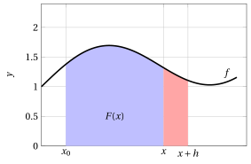

# Teorema fondamentale del calcolo integrale

**Parte 7 · Integrali · Capitolo 2** · [:material-file-pdf-box: Dispensa, volume 7 (PDF)](../pdf/dispensa-7-integrali.pdf) · [:material-pencil-box-multiple: Esercizi, volume 7 (PDF)](../pdf/esercizi-7-integrali.pdf) · [:material-pencil: Esercizi: Primitive](../esercizi/es-integrali-01-primitive.md) · [:material-pencil: Esercizi: Funzioni integrali e teorema fondamentale](../esercizi/es-integrali-04-funzioni-integrali.md) · [:material-presentation: Slide (PDF)](../pdf/slide-integrali-02-teorema-fondamentale.pdf)

!!! nota "Prerequisiti"

    - Da questo modulo, [«L'integrale di Riemann»](https://fabiofurini.github.io/analisi-matematica-1/integrali/01-integrale-riemann/): definizione e proprietà dell'integrale, teorema della media integrale.

    - Da questo modulo, [«Funzione derivata»](https://fabiofurini.github.io/analisi-matematica-1/derivate/01-funzione-derivata/), [«Derivate di funzioni elementari»](https://fabiofurini.github.io/analisi-matematica-1/derivate/02-derivate-elementari/) e [«Regole di calcolo delle derivate»](https://fabiofurini.github.io/analisi-matematica-1/derivate/04-regole-calcolo/): derivate e regola della catena.

    - Da questo modulo, [«Teorema del valore medio, massimi e minimi»](https://fabiofurini.github.io/analisi-matematica-1/derivate/05-valor-medio/): una funzione con derivata nulla in un intervallo è costante.

    - Da questo modulo, [«Teorema di De l'Hospital e derivabilità»](https://fabiofurini.github.io/analisi-matematica-1/derivate/06-de-l-hospital/): il teorema di De l'Hospital.

!!! chiave "Obiettivi"

    Alla fine di questo capitolo sarai in grado di:

    - riconoscere una primitiva e descrivere tutte le primitive di una funzione su un intervallo;

    - enunciare e dimostrare le due parti del teorema fondamentale del calcolo integrale;

    - calcolare integrali definiti con una primitiva e la tabella delle primitive immediate;

    - derivare funzioni integrali con estremi variabili e usarle nei limiti e negli studi di funzione.

## 1. Primitive

!!! definizione "Definizione 1: di primitiva"

    Sia $f: I \rr \R$, con $I$ intervallo. Una funzione $F: I \rr \R$ si dice <strong>primitiva</strong> di $f$ in $I$ se $F$ è derivabile in $I$ e

    $$
    F'(x) = f(x), ~~~ \forall x \in I
    $$

- Trovare una primitiva è il procedimento inverso della derivazione: si cerca una funzione conoscendone la derivata.

- Se $I$ contiene un estremo, in quel punto la derivata è unilaterale.

!!! esempio "Esempio 1: primitive"

    - $F(x) = \frac{x^3}{3}$ è una primitiva di $f(x) = x^2$ in $\R$, perché $F'(x) = x^2$; lo è anche $\frac{x^3}{3} + 5$.

    - $F(x) = \sin x$ è una primitiva di $f(x) = \cos x$ in $\R$.

    - $F(x) = \log x$ è una primitiva di $f(x) = \frac1x$ in $(0, \ip)$; $F(x) = \log(-x)$ lo è in $(\im, 0)$.

!!! teorema "Teorema 1: di caratterizzazione delle primitive"

    Sia $F$ una primitiva di $f$ nell'intervallo $I$. Allora $G$ è una primitiva di $f$ in $I$ se e solo se esiste una costante $c \in \R$ tale che

    $$
    G(x) = F(x) + c, ~~~ \forall x \in I
    $$

??? dimostrazione "Dimostrazione"

    - <strong>($\Leftarrow$)</strong> Se $G = F + c$, allora $G' = F' + 0 = f$ in $I$.

    - <strong>($\Rightarrow$)</strong> La funzione $H = G - F$ ha derivata $H' = f - f = 0$ in tutto l'intervallo $I$. Per il corollario del teorema di Lagrange, una funzione con derivata nulla in un intervallo è costante: $H(x) = c$ per ogni $x \in I$.

    
□

!!! osservazione "Osservazione 1"

    L'ipotesi che $I$ sia un intervallo è essenziale. In $\R \setminus \{0\}$ le funzioni

    $$
    F(x) = \log|x| {\rm ~~~~e~~~~} G(x) = \begin{cases} \log|x| + 1 & {\rm se~} x > 0 \\ \log|x| & {\rm se~} x < 0 \end{cases}
    $$

    hanno entrambe derivata $\frac1x$, ma $G - F$ non è costante: vale $1$ per $x > 0$ e $0$ per $x < 0$.

!!! definizione "Definizione 2: di integrale indefinito"

    L'insieme di tutte le primitive di $f$ in un intervallo $I$ si chiama <strong>integrale indefinito</strong> di $f$ e si indica con $\int f(x)\,dx$. Se $F$ è una primitiva, si scrive

    $$
    \int f(x)\,dx = F(x) + c, ~~~ c \in \R
    $$

- Dalla linearità della derivata segue la <strong>linearità dell'integrale indefinito</strong>: $\int (\alpha f + \beta g)\,dx = \alpha \int f\,dx + \beta \int g\,dx$.

- Non bisogna confondere l'integrale indefinito, che è un insieme di funzioni, con l'integrale definito $\int_a^b f(x)\,dx$, che è un numero. Il teorema fondamentale del calcolo integrale mostra il legame fra i due.

## 2. La funzione integrale

!!! definizione "Definizione 3: di funzione integrale"

    Sia $f$ integrabile in $[a,b]$ e sia $x_0 \in [a,b]$. La funzione

    $$
    F(x) = \int_{x_0}^{x} f(t)\,dt, ~~~ x \in [a,b]
    $$

    si chiama <strong>funzione integrale</strong> di $f$ con punto iniziale $x_0$.

- La variabile di integrazione si chiama $t$ per non confonderla con l'estremo superiore $x$.

- Per $x < x_0$ vale la convenzione $\int_{x_0}^{x} f = -\int_{x}^{x_0} f$; inoltre $F(x_0) = 0$.

!!! esempio "Esempio 2: una funzione integrale"

    Sia $f(t) = t$ e $x_0 = 0$. Per $x > 0$ l'integrale $\int_0^x t\,dt$ è l'area del triangolo di base e altezza $x$, cioè $\frac{x^2}{2}$. Per $x < 0$

    $$
    \int_0^x t\,dt = -\int_x^0 t\,dt = -\left(-\frac{x^2}{2}\right) = \frac{x^2}{2}
    $$

    perché fra $x$ e $0$ il grafico sta sotto l'asse. Quindi $F(x) = \frac{x^2}{2}$ per ogni $x \in \R$: la funzione integrale di $f(t) = t$ è una sua primitiva.

!!! teorema "Proposizione 1: di continuità della funzione integrale"

    Se $f$ è integrabile in $[a,b]$ e $|f(t)| \le L$ per ogni $t \in [a,b]$, allora la funzione integrale $F$ soddisfa

    $$
    |F(x) - F(y)| \le L\,|x - y|, ~~~ \forall x, y \in [a,b]
    $$

    In particolare $F$ è continua in $[a,b]$.

??? dimostrazione "Dimostrazione"

    Sia $y < x$. Per l'additività rispetto all'intervallo, $F(x) - F(y) = \int_y^x f(t)\,dt$. Per la disuguaglianza del valore assoluto e per il Corollario delle stime dell'integrale

    $$
    |F(x) - F(y)| \le \int_y^x |f(t)|\,dt \le L\,(x - y)
    $$

    Quando $y \rr x$ il secondo membro tende a $0$, quindi $F$ è continua. □

## 3. Teorema fondamentale del calcolo integrale

!!! teorema "Teorema 2: fondamentale del calcolo integrale, prima parte"

    Sia $f:[a,b] \rr \R$ continua e sia $x_0 \in [a,b]$. La funzione integrale

    $$
    F(x) = \int_{x_0}^{x} f(t)\,dt
    $$

    è derivabile in $[a,b]$ e

    $$
    F'(x) = f(x), ~~~ \forall x \in [a,b]
    $$

    cioè $F$ è una primitiva di $f$ in $[a,b]$.

??? dimostrazione "Dimostrazione"

    Sia $x \in [a,b]$ e sia $h \neq 0$ con $x + h \in [a,b]$. Per l'additività rispetto all'intervallo

    $$
    \frac{F(x+h) - F(x)}{h} = \frac{1}{h}\int_x^{x+h} f(t)\,dt
    $$

    Il secondo membro è la media integrale di $f$ nell'intervallo di estremi $x$ e $x+h$ (anche per $h < 0$, scambiando gli estremi). Per il Teorema della media integrale esiste $c_h$ compreso fra $x$ e $x + h$ tale che

    $$
    \frac{F(x+h) - F(x)}{h} = f(c_h)
    $$

    Quando $h \rr 0$ si ha $c_h \rr x$ e, per la continuità di $f$, $f(c_h) \rr f(x)$. Il limite del rapporto incrementale esiste e vale $f(x)$. □

{ .fig .ovale loading=lazy style="width:65%" }

- Nella figura l'area blu è $F(x)$ e la striscia rossa è $F(x+h) - F(x)$: per $h$ piccolo è quasi un rettangolo di base $h$ e altezza $f(x)$. Dividendo per $h$ si ottiene circa $f(x)$.

- Ogni funzione continua su un intervallo ha quindi una primitiva, anche quando questa non si scrive con le funzioni elementari (per esempio $e^{-x^2}$).

!!! teorema "Teorema 3: fondamentale del calcolo integrale, seconda parte"

    Sia $f:[a,b] \rr \R$ continua e sia $G$ una qualunque primitiva di $f$ in $[a,b]$. Allora

    $$
    \int_a^b f(x)\,dx = G(b) - G(a)
    $$

??? dimostrazione "Dimostrazione"

    Per il Teorema fondamentale del calcolo integrale, prima parte, la funzione $F(x) = \int_a^x f(t)\,dt$ è una primitiva di $f$ in $[a,b]$. Per il Teorema di caratterizzazione delle primitive esiste $c \in \R$ con $G = F + c$ in $[a,b]$. Allora

    $$
    G(b) - G(a) = \big(F(b) + c\big) - \big(F(a) + c\big) = \int_a^b f(t)\,dt - 0
    $$

    
□

- Si scrive $G(b) - G(a) = \big[ G(x) \big]_a^b$. La seconda parte è chiamata anche <strong>formula fondamentale del calcolo integrale</strong>: per calcolare un integrale definito basta una primitiva.

!!! esempio "Esempio 3: integrali definiti con una primitiva"

    - $\displaystyle \int_0^1 x^2\,dx = \left[\frac{x^3}{3}\right]_0^1 = \frac13$, come avevamo ottenuto con le somme di Riemann.

    - $\displaystyle \int_0^{\pi} \sin x\,dx = \big[-\cos x\big]_0^{\pi} = -\cos\pi + \cos 0 = 2$.

    - $\displaystyle \int_1^{e} \frac{1}{x}\,dx = \big[\log x\big]_1^{e} = 1 - 0 = 1$.

    - $\displaystyle \int_0^{2\pi} \sin x\,dx = \big[-\cos x\big]_0^{2\pi} = 0$, mentre $\displaystyle \int_0^{2\pi} |\sin x|\,dx = 2\int_0^{\pi} \sin x\,dx = 4$.

## 4. Primitive immediate

- Leggendo al contrario la tabella delle derivate delle funzioni elementari si ottengono le <strong>primitive immediate</strong>. Ogni riga si verifica derivando il secondo membro.

<table>
<tr>
<td>\(f(x)\)</td>
<td>\(\displaystyle\int f(x)\,dx\)</td>
</tr>
<tr>
<td>\(x^{\alpha}\),   \(\alpha \neq -1\)</td>
<td>\(\displaystyle\frac{x^{\alpha+1}}{\alpha+1} + c\)</td>
</tr>
<tr>
<td>\(\displaystyle\frac{1}{x}\)</td>
<td>\(\log|x| + c\)</td>
</tr>
<tr>
<td>\(e^{x}\)</td>
<td>\(e^{x} + c\)</td>
</tr>
<tr>
<td>\(a^{x}\),   \(a > 0\), \(a \neq 1\)</td>
<td>\(\displaystyle\frac{a^{x}}{\log a} + c\)</td>
</tr>
<tr>
<td>\(\sin x\)</td>
<td>\(-\cos x + c\)</td>
</tr>
<tr>
<td>\(\cos x\)</td>
<td>\(\sin x + c\)</td>
</tr>
<tr>
<td>\(\displaystyle\frac{1}{\cos^2 x} = 1 + \tan^2 x\)</td>
<td>\(\tan x + c\)</td>
</tr>
<tr>
<td>\(\displaystyle\frac{1}{1+x^2}\)</td>
<td>\(\arctan x + c\)</td>
</tr>
<tr>
<td>\(\displaystyle\frac{1}{\sqrt{1-x^2}}\)</td>
<td>\(\arcsin x + c\)</td>
</tr>
<tr>
<td>\(\sinH x\)</td>
<td>\(\cosH x + c\)</td>
</tr>
<tr>
<td>\(\cosH x\)</td>
<td>\(\sinH x + c\)</td>
</tr>
</table>

- Ogni formula vale in un intervallo in cui la funzione è definita: per esempio $\int \frac1x\,dx = \log|x| + c$ in $(0,\ip)$ oppure in $(\im, 0)$.

- Per la regola della catena, se $g$ è derivabile, la tabella vale anche nella forma <strong>composta</strong>: per esempio

    $$
    \int g'(x)\, g(x)^{\alpha}\,dx = \frac{g(x)^{\alpha+1}}{\alpha+1} + c, ~~~~ \int \frac{g'(x)}{g(x)}\,dx = \log|g(x)| + c, ~~~~ \int g'(x)\, e^{g(x)}\,dx = e^{g(x)} + c
    $$

!!! esempio "Esempio 4: primitive immediate e linearità"

    - $\displaystyle \int \left(3x^2 - \frac{4}{x} + 2e^x\right) dx = x^3 - 4\log|x| + 2e^x + c$.

    - $\displaystyle \int \sqrt{x}\,dx = \int x^{1/2}\,dx = \frac{2}{3}\,x^{3/2} + c$, in $(0, \ip)$.

    - $\displaystyle \int \tan x\,dx = -\int \frac{-\sin x}{\cos x}\,dx = -\log|\cos x| + c$, con $g(x) = \cos x$.

    - $\displaystyle \int \frac{x}{1+x^2}\,dx = \frac12 \int \frac{2x}{1+x^2}\,dx = \frac12 \log(1+x^2) + c$.

    - $\displaystyle \int_0^1 \frac{1}{1+x^2}\,dx = \big[\arctan x\big]_0^1 = \frac{\pi}{4}$.

## 5. Derivata di una funzione integrale

!!! teorema "Teorema 4: di derivazione delle funzioni integrali"

    Sia $f$ continua nell'intervallo $I$ e siano $\alpha$ e $\beta$ funzioni derivabili in un intervallo $J$, a valori in $I$. Allora la funzione

    $$
    G(x) = \int_{\alpha(x)}^{\beta(x)} f(t)\,dt, ~~~ x \in J
    $$

    è derivabile in $J$ e

    $$
    G'(x) = f\big(\beta(x)\big)\,\beta'(x) - f\big(\alpha(x)\big)\,\alpha'(x)
    $$

??? dimostrazione "Dimostrazione"

    Sia $F$ una primitiva di $f$ in $I$, che esiste per il Teorema fondamentale del calcolo integrale, prima parte. Per la seconda parte

    $$
    G(x) = F\big(\beta(x)\big) - F\big(\alpha(x)\big)
    $$

    Per la regola della catena e per $F' = f$ si ottiene la tesi. □

!!! esempio "Esempio 5: derivate di funzioni integrali"

    - Se $G(x) = \displaystyle\int_1^{x^2} e^{t^2}\,dt$, allora $G'(x) = e^{(x^2)^2}\cdot 2x = 2x\,e^{x^4}$.

    - Se $G(x) = \displaystyle\int_{x}^{3x} \frac{1}{1+t^2}\,dt$, allora $G'(x) = \frac{3}{1+9x^2} - \frac{1}{1+x^2}$.

!!! esempio "Esempio 6: un limite con una funzione integrale"

    Calcoliamo

    $$
    \lim_{x \rr 0} \frac{1}{x^3}\int_0^{x} \sin(t^2)\,dt
    $$

    La funzione $\sin(t^2)$ non ha una primitiva elementare, ma il numeratore $F(x) = \int_0^x \sin(t^2)\,dt$ tende a $F(0) = 0$ ed è derivabile con $F'(x) = \sin(x^2)$. Si ha una forma $\frac00$ e, per il Teorema di De l'Hospital e il limite notevole del seno,

    $$
    \lim_{x \rr 0} \frac{\sin(x^2)}{3x^2} = \frac13 {\rm ~~~~quindi~~~~} \lim_{x \rr 0} \frac{1}{x^3}\int_0^{x} \sin(t^2)\,dt = \frac13
    $$

!!! esempio "Esempio 7: studio di una funzione integrale"

    Sia $F(x) = \displaystyle\int_0^{x} e^{-t^2}\,dt$, $x \in \R$.

    - <strong>Monotonia.</strong> $F'(x) = e^{-x^2} > 0$: $F$ è crescente in $\R$ e $F(0) = 0$, quindi $F(x) > 0$ per $x > 0$ e $F(x) < 0$ per $x < 0$.

    - <strong>Concavità.</strong> $F''(x) = -2x\,e^{-x^2}$: $F$ è convessa in $(\im, 0]$, concava in $[0, \ip)$ e ha un flesso in $x = 0$, con tangente $y = x$.

    - <strong>Simmetria.</strong> La funzione $H(x) = F(x) + F(-x)$ ha derivata $H'(x) = e^{-x^2} - e^{-x^2} = 0$, quindi è costante e vale $H(0) = 0$: $F$ è dispari.

## 6. In sintesi

!!! chiave "In sintesi"

    - Una primitiva di $f$ in un intervallo è una funzione con derivata $f$; due primitive sullo stesso intervallo differiscono per una costante.

    - La funzione integrale $F(x) = \int_{x_0}^x f(t)\,dt$ è continua; se $f$ è continua, $F$ è derivabile e $F' = f$ (prima parte del teorema fondamentale).

    - Se $G$ è una primitiva della funzione continua $f$, allora $\int_a^b f(x)\,dx = G(b) - G(a)$ (seconda parte).

    - Le primitive immediate si ottengono leggendo al contrario la tabella delle derivate, anche nella forma composta con $g'(x)$.

    - $\frac{d}{dx}\int_{\alpha(x)}^{\beta(x)} f(t)\,dt = f(\beta(x))\,\beta'(x) - f(\alpha(x))\,\alpha'(x)$: serve nei limiti (con De l'Hospital) e negli studi di funzioni integrali.

---

**Esercizi su questo capitolo:** [:material-pencil: Primitive](../esercizi/es-integrali-01-primitive.md) · [:material-pencil: Funzioni integrali e teorema fondamentale](../esercizi/es-integrali-04-funzioni-integrali.md)

