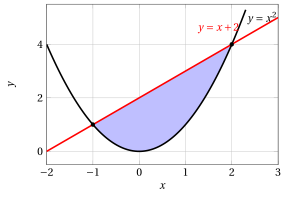

# Tecniche di integrazione e applicazioni

**Parte 7 · Integrali · Capitolo 3** · [:material-file-pdf-box: Dispensa, volume 7 (PDF)](../pdf/dispensa-7-integrali.pdf) · [:material-pencil-box-multiple: Esercizi, volume 7 (PDF)](../pdf/esercizi-7-integrali.pdf) · [:material-pencil: Esercizi: Primitive](../esercizi/es-integrali-01-primitive.md) · [:material-pencil: Esercizi: Integrali](../esercizi/es-integrali-02-integrali.md) · [:material-pencil: Esercizi: Integrali definiti, aree e valor medio](../esercizi/es-integrali-05-integrali-definiti-aree.md) · [:material-presentation: Slide (PDF)](../pdf/slide-integrali-03-tecniche-integrazione.pdf)

## 1. Integrazione per sostituzione

!!! teorema "Teorema 1: di integrazione per sostituzione"

    Sia $f$ continua nell'intervallo $I$, sia $F$ una sua primitiva e sia $g: J \rr I$ derivabile con derivata continua nell'intervallo $J$. Allora

    $$
    i)~~~~ \int f\big(g(x)\big)\,g'(x)\,dx = F\big(g(x)\big) + c
    $$

    $$
    ii)~~~~ \int_a^b f\big(g(x)\big)\,g'(x)\,dx = \int_{g(a)}^{g(b)} f(t)\,dt, ~~~ \forall a, b \in J
    $$

??? dimostrazione "Dimostrazione"

    - <strong>$i)$</strong> Per la regola della catena $\big(F(g(x))\big)' = F'\big(g(x)\big)\,g'(x) = f\big(g(x)\big)\,g'(x)$: la funzione $F \circ g$ è una primitiva dell'integranda.

    - <strong>$ii)$</strong> L'integranda a sinistra è continua. Per la formula fondamentale del calcolo integrale e per $i)$ entrambi i membri valgono $F\big(g(b)\big) - F\big(g(a)\big)$.

    
□

- In pratica si pone $t = g(x)$ e si sostituisce formalmente $dt = g'(x)\,dx$. Negli integrali definiti cambiano anche gli estremi: $x = a$ diventa $t = g(a)$, $x = b$ diventa $t = g(b)$.

!!! esempio "Esempio 1: sostituzione"

    - $\displaystyle \int x\,e^{x^2}\,dx$: con $t = x^2$, $dt = 2x\,dx$, si ha $\displaystyle \frac12 \int e^{t}\,dt = \frac12\,e^{x^2} + c$.

    - $\displaystyle \int \cos x\,\sin^3 x\,dx$: con $t = \sin x$, $dt = \cos x\,dx$, si ha $\displaystyle \int t^3\,dt = \frac{\sin^4 x}{4} + c$.

    - $\displaystyle \int_0^1 x\sqrt{1+x^2}\,dx$: con $t = 1 + x^2$, $dt = 2x\,dx$, gli estremi diventano $t = 1$ e $t = 2$:

        $$
        \int_0^1 x\sqrt{1+x^2}\,dx = \frac12\int_1^2 \sqrt{t}\,dt = \frac12 \left[\frac{2}{3}\,t^{3/2}\right]_1^2 = \frac{2\sqrt2 - 1}{3}
        $$

!!! osservazione "Osservazione 1: cambio di variabile"

    La formula $ii)$ si usa anche da destra verso sinistra: per calcolare $\int_{\alpha}^{\beta} f(x)\,dx$ si pone $x = \varphi(t)$, con $\varphi$ derivabile con derivata continua e invertibile, e

    $$
    \int_{\alpha}^{\beta} f(x)\,dx = \int_{\varphi^{-1}(\alpha)}^{\varphi^{-1}(\beta)} f\big(\varphi(t)\big)\,\varphi'(t)\,dt
    $$

    Per un integrale indefinito, alla fine si torna alla variabile $x$ con $t = \varphi^{-1}(x)$.

!!! esempio "Esempio 2: cambio di variabile"

    - $\displaystyle \int \frac{\sqrt{x}}{1+x}\,dx$, per $x > 0$: con $x = t^2$, $t = \sqrt{x} > 0$, $dx = 2t\,dt$,

        $$
        \int \frac{2t^2}{1+t^2}\,dt = 2\int \left(1 - \frac{1}{1+t^2}\right) dt = 2t - 2\arctan t + c = 2\sqrt{x} - 2\arctan\sqrt{x} + c
        $$

    - $\displaystyle \int_0^1 \sqrt{1-x^2}\,dx$: con $x = \sin t$, $t \in \left[0, \frac{\pi}{2}\right]$, si ha $dx = \cos t\,dt$ e $\sqrt{1 - \sin^2 t} = \cos t$ (perché $\cos t \ge 0$). Usando $\cos^2 t = \frac{1 + \cos 2t}{2}$,

        $$
        \int_0^1 \sqrt{1-x^2}\,dx = \int_0^{\pi/2} \cos^2 t\,dt = \left[\frac{t}{2} + \frac{\sin 2t}{4}\right]_0^{\pi/2} = \frac{\pi}{4}
        $$

        È l'area di un quarto del cerchio di raggio $1$.

## 2. Integrazione per parti

!!! teorema "Teorema 2: di integrazione per parti"

    Siano $f$ e $g$ derivabili con derivata continua nell'intervallo $I$. Allora

    $$
    i)~~~~ \int f(x)\,g'(x)\,dx = f(x)\,g(x) - \int f'(x)\,g(x)\,dx
    $$

    $$
    ii)~~~~ \int_a^b f(x)\,g'(x)\,dx = \big[ f(x)\,g(x) \big]_a^b - \int_a^b f'(x)\,g(x)\,dx, ~~~ \forall a, b \in I
    $$

??? dimostrazione "Dimostrazione"

    Per la regola di derivazione del prodotto $(f\,g)' = f'\,g + f\,g'$: la funzione $f\,g$ è una primitiva di $f'\,g + f\,g'$. Per la linearità dell'integrale indefinito

    $$
    f(x)\,g(x) + c = \int f'(x)\,g(x)\,dx + \int f(x)\,g'(x)\,dx
    $$

    che è $i)$. Per $ii)$ si integra $(f\,g)' = f'\,g + f\,g'$ fra $a$ e $b$ con la formula fondamentale del calcolo integrale e la linearità. □

- $f$ si chiama <strong>fattore finito</strong> e $g'$ <strong>fattore differenziale</strong>. Conviene scegliere come $f$ il fattore che si semplifica derivando (un polinomio, un logaritmo, un'arcotangente) e come $g'$ quello di cui si conosce una primitiva.

!!! esempio "Esempio 3: per parti"

    - $\displaystyle \int x\,e^{x}\,dx$: con $f = x$, $g' = e^x$, si ha $\displaystyle x\,e^{x} - \int e^{x}\,dx = (x - 1)\,e^{x} + c$.

    - $\displaystyle \int \log x\,dx$, per $x > 0$: con $f = \log x$, $g' = 1$, si ha $\displaystyle x\log x - \int x \cdot \frac{1}{x}\,dx = x\log x - x + c$.

    - $\displaystyle \int \arctan x\,dx$: con $f = \arctan x$, $g' = 1$, si ha $\displaystyle x\arctan x - \int \frac{x}{1+x^2}\,dx = x\arctan x - \frac12\log(1+x^2) + c$.

    - $\displaystyle \int_0^{\pi} x\sin x\,dx$: con $f = x$, $g' = \sin x$,

        $$
        \int_0^{\pi} x\sin x\,dx = \big[-x\cos x\big]_0^{\pi} + \int_0^{\pi} \cos x\,dx = \pi + \big[\sin x\big]_0^{\pi} = \pi
        $$

!!! esempio "Esempio 4: integrale che ritorna"

    Sia $I = \int e^{x}\sin x\,dx$. Integrando due volte per parti, con $g' = e^x$ entrambe le volte,

    $$
    I = e^{x}\sin x - \int e^{x}\cos x\,dx = e^{x}\sin x - \left( e^{x}\cos x + \int e^{x}\sin x\,dx \right) = e^{x}(\sin x - \cos x) - I
    $$

    Ricavando $I$ dall'uguaglianza (a meno della costante):

    $$
    \int e^{x}\sin x\,dx = \frac{e^{x}\,(\sin x - \cos x)}{2} + c
    $$

## 3. Integrazione delle funzioni razionali

- Vogliamo calcolare $\int \frac{P(x)}{Q(x)}\,dx$ con $P$ e $Q$ polinomi. Se $\deg P \ge \deg Q$, si divide: $P = A\,Q + R$ con $\deg R < \deg Q$, e

    $$
    \frac{P(x)}{Q(x)} = A(x) + \frac{R(x)}{Q(x)}
    $$

    Il polinomio $A$ si integra subito; resta una funzione razionale <strong>propria</strong>, con il grado del numeratore minore di quello del denominatore.

### 3.1 Denominatore di primo e di secondo grado

- <strong>Primo grado</strong>: $\displaystyle \int \frac{1}{x - x_1}\,dx = \log|x - x_1| + c$.

- <strong>Secondo grado</strong>, $Q(x) = x^2 + px + q$ con discriminante $\Delta = p^2 - 4q$:

    - $\Delta > 0$: $Q(x) = (x - x_1)(x - x_2)$ e si cercano $A$, $B$ con $\displaystyle \frac{R(x)}{Q(x)} = \frac{A}{x - x_1} + \frac{B}{x - x_2}$;

    - $\Delta = 0$: $Q(x) = (x - x_1)^2$ e $\displaystyle \frac{R(x)}{Q(x)} = \frac{A}{x - x_1} + \frac{B}{(x - x_1)^2}$, con $\displaystyle \int \frac{dx}{(x - x_1)^2} = -\frac{1}{x - x_1} + c$;

    - $\Delta < 0$: si completa il quadrato, $Q(x) = \left(x + \frac{p}{2}\right)^2 + k^2$ con $k^2 = -\frac{\Delta}{4}$, e si scrive il numeratore come multiplo di $Q'(x) = 2x + p$ più una costante.

- Nel caso $\Delta < 0$ servono le due primitive

    $$
    \int \frac{2x + p}{x^2 + px + q}\,dx = \log(x^2 + px + q) + c, ~~~~~ \int \frac{dx}{(x + p/2)^2 + k^2} = \frac{1}{k}\arctan\frac{x + p/2}{k} + c
    $$

!!! osservazione "Osservazione 2: decomposizione in fratti semplici"

    Si dimostra che ogni polinomio reale $Q$ è il prodotto di una costante, di fattori di primo grado $(x - a)$ e di fattori di secondo grado $x^2 + px + q$ con $\Delta < 0$, eventualmente ripetuti. Una funzione razionale propria $\frac{R}{Q}$ è la somma di <strong>fratti semplici</strong>: per ogni fattore $(x - a)^m$ i termini $\frac{A_1}{x-a} + \dots + \frac{A_m}{(x-a)^m}$, per ogni fattore $x^2 + px + q$ (non ripetuto) un termine $\frac{Mx + N}{x^2 + px + q}$. Le costanti si trovano uguagliando i numeratori.

!!! esempio "Esempio 5: funzioni razionali"

    - <strong>Divisione.</strong> $x^3 + x + 1 = x\,(x^2 + 1) + 1$, quindi $\displaystyle \int \frac{x^3 + x + 1}{x^2 + 1}\,dx = \int \left(x + \frac{1}{x^2+1}\right) dx = \frac{x^2}{2} + \arctan x + c$.

    - <strong>$\Delta > 0$.</strong> $\displaystyle \frac{1}{x^2 - 1} = \frac{A}{x - 1} + \frac{B}{x + 1}$ dà $1 = A(x+1) + B(x-1)$: con $x = 1$ e $x = -1$ si ottiene $A = \frac12$, $B = -\frac12$, e

        $$
        \int \frac{dx}{x^2 - 1} = \frac12 \log\left|\frac{x-1}{x+1}\right| + c
        $$

    - <strong>$\Delta = 0$.</strong> $2x + 3 = 2(x+1) + 1$, quindi $\displaystyle \int \frac{2x+3}{(x+1)^2}\,dx = \int \left(\frac{2}{x+1} + \frac{1}{(x+1)^2}\right) dx = 2\log|x+1| - \frac{1}{x+1} + c$.

    - <strong>$\Delta < 0$.</strong> $x^2 + 2x + 5 = (x+1)^2 + 4$ e $x + 3 = \frac12(2x + 2) + 2$, quindi

        $$
        \int \frac{x+3}{x^2+2x+5}\,dx = \frac12\log(x^2 + 2x + 5) + \arctan\frac{x+1}{2} + c
        $$

!!! esempio "Esempio 6: un fattore ripetuto e un integrale definito"

    - $\displaystyle \frac{1}{x(x+1)^2} = \frac{A}{x} + \frac{B}{x+1} + \frac{C}{(x+1)^2}$ dà $1 = A(x+1)^2 + Bx(x+1) + Cx$. Con $x = 0$: $A = 1$; con $x = -1$: $C = -1$; confrontando i coefficienti di $x^2$: $A + B = 0$, cioè $B = -1$. Quindi

        $$
        \int \frac{dx}{x(x+1)^2} = \log|x| - \log|x+1| + \frac{1}{x+1} + c
        $$

    - Con la primitiva dell'esempio precedente,

        $$
        \int_2^3 \frac{dx}{x^2-1} = \frac12\left[\log\frac{x-1}{x+1}\right]_2^3 = \frac12\left(\log\frac12 - \log\frac13\right) = \frac12\log\frac32
        $$

## 4. Aree di regioni piane

!!! teorema "Proposizione 1: dell'area fra due grafici"

    Siano $f$ e $g$ continue in $[a,b]$ con $f(x) \le g(x)$ per ogni $x \in [a,b]$. L'area della regione

    $$
    D = \big\{ (x,y) \in \R^2 : a \le x \le b, ~ f(x) \le y \le g(x) \big\}
    $$

    è

    $$
    {\rm Area}(D) = \int_a^b \big( g(x) - f(x) \big)\,dx
    $$

??? dimostrazione "Dimostrazione"

    Per il Teorema di Weierstrass $f$ è limitata inferiormente: esiste una costante $c$ con $f + c \ge 0$ in $[a,b]$. Traslare verso l'alto di $c$ non cambia l'area, e la regione traslata è il trapezoide di $g + c$ privato di quello di $f + c$. Per l'interpretazione geometrica dell'integrale e per la linearità

    $$
    {\rm Area}(D) = \int_a^b (g + c)\,dx - \int_a^b (f + c)\,dx = \int_a^b (g - f)\,dx
    $$

    
□

- L'area della regione compresa fra il grafico di $f$ e l'asse $x$ è $\int_a^b |f(x)|\,dx$: si divide $[a,b]$ negli intervalli in cui $f$ ha segno costante.

- Se i due grafici si incrociano, l'area fra di essi è $\int_a^b |g(x) - f(x)|\,dx$: si cercano prima i punti di intersezione.

{ .fig .ovale loading=lazy style="width:65%" }

!!! esempio "Esempio 7: area fra una parabola e una retta"

    Calcoliamo l'area della regione compresa fra $y = x^2$ e $y = x + 2$ (in blu nella figura). Le intersezioni si trovano da $x^2 = x + 2$: $x = -1$ e $x = 2$. In $[-1, 2]$ la retta sta sopra la parabola, quindi

    $$
    {\rm Area} = \int_{-1}^{2} \big( x + 2 - x^2 \big)\,dx = \left[\frac{x^2}{2} + 2x - \frac{x^3}{3}\right]_{-1}^{2} = \frac{10}{3} - \left(-\frac{7}{6}\right) = \frac{9}{2}
    $$

!!! esempio "Esempio 8: grafici che si incrociano"

    Calcoliamo l'area fra $y = \sin x$ e $y = \cos x$ per $x \in \left[0, \frac{\pi}{2}\right]$. I grafici si incrociano in $x = \frac{\pi}{4}$: prima sta sopra il coseno, poi il seno. Quindi

    $$
    {\rm Area} = \int_0^{\pi/4} (\cos x - \sin x)\,dx + \int_{\pi/4}^{\pi/2} (\sin x - \cos x)\,dx
    $$

    $$
    = \big[\sin x + \cos x\big]_0^{\pi/4} + \big[-\cos x - \sin x\big]_{\pi/4}^{\pi/2} = (\sqrt2 - 1) + (\sqrt2 - 1) = 2\sqrt2 - 2
    $$

!!! esempio "Esempio 9: area sotto il logaritmo"

    In $[1, e]$ si ha $\log x \ge 0$. Con la primitiva trovata per parti,

    $$
    {\rm Area} = \int_1^{e} \log x\,dx = \big[x\log x - x\big]_1^{e} = (e - e) - (0 - 1) = 1
    $$

## 5. Valor medio di una funzione

- Il valor medio di $f$ in $[a,b]$ è la media integrale $\frac{1}{b-a}\int_a^b f(x)\,dx$: ora la sappiamo calcolare con una primitiva.

- È la naturale estensione della media aritmetica $\frac1n \sum_{k=1}^n f(x_k)$: con la partizione uniforme, $\frac1n\sum_{k=1}^n f(x_k) = \frac{1}{b-a}\sum_{k=1}^n f(x_k)\,\frac{b-a}{n}$ è una somma di Riemann divisa per $b - a$.

!!! esempio "Esempio 10: valori medi"

    - Il valor medio di $\sin x$ in $[0, \pi]$ è $\displaystyle \frac{1}{\pi}\int_0^{\pi} \sin x\,dx = \frac{2}{\pi} \approx 0{,}64$.

    - Il valor medio di $x^2$ in $[0, 3]$ è $\displaystyle \frac13\left[\frac{x^3}{3}\right]_0^3 = 3$; come prevede il Teorema della media integrale è assunto in $c = \sqrt3 \in [0,3]$.

    - Se un punto si muove con velocità $v(t) = 3t^2$ (metri al secondo) per $t \in [0, 2]$, lo spazio percorso è $\int_0^2 3t^2\,dt = 8$ metri e la velocità media è $\frac{8}{2} = 4$ metri al secondo.

!!! chiave "In sintesi"

    - <strong>Sostituzione</strong>: $\int_a^b f(g(x))\,g'(x)\,dx = \int_{g(a)}^{g(b)} f(t)\,dt$; con $t = g(x)$ cambiano integranda, differenziale ed estremi. Letta al contrario è il cambio di variabile $x = \varphi(t)$.

    - <strong>Per parti</strong>: $\int f\,g' = f\,g - \int f'\,g$; si deriva il fattore che si semplifica. A volte l'integrale ritorna e si ricava da un'equazione.

    - <strong>Funzioni razionali</strong>: divisione se serve, poi fratti semplici secondo i fattori del denominatore; i fattori di secondo grado con $\Delta < 0$ danno un logaritmo e un'arcotangente.

    - L'area fra due grafici è $\int_a^b |g - f|$, dopo aver trovato le intersezioni.

    - Il valor medio $\frac{1}{b-a}\int_a^b f$ estende la media aritmetica: è la velocità media se $f$ è una velocità.

---

**Esercizi su questo capitolo:** [:material-pencil: Primitive](../esercizi/es-integrali-01-primitive.md) · [:material-pencil: Integrali](../esercizi/es-integrali-02-integrali.md) · [:material-pencil: Integrali definiti, aree e valor medio](../esercizi/es-integrali-05-integrali-definiti-aree.md)

