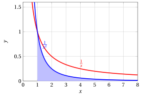
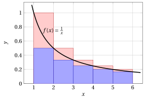

# Integrali impropri

**Parte 7 · Integrali · Capitolo 4** · [:material-file-pdf-box: Dispensa, volume 7 (PDF)](../pdf/dispensa-7-integrali.pdf) · [:material-pencil-box-multiple: Esercizi, volume 7 (PDF)](../pdf/esercizi-7-integrali.pdf) · [:material-pencil: Esercizi: Integrali](../esercizi/es-integrali-02-integrali.md) · [:material-pencil: Esercizi: Integrali impropri](../esercizi/es-integrali-06-integrali-impropri.md) · [:material-presentation: Slide (PDF)](../pdf/slide-integrali-04-integrali-impropri.pdf)

## 1. Integrali su intervalli illimitati

!!! definizione "Definizione 1: di integrale improprio su un intervallo illimitato"

    Sia $f$ continua in $[a, \ip)$. Si chiama <strong>integrale improprio</strong> di $f$ in $[a,\ip)$ il limite

    $$
    \int_a^{\ip} f(x)\,dx = \lim_{\omega \rr \ip} \int_a^{\omega} f(x)\,dx
    $$

    Se il limite è finito l'integrale si dice <strong>convergente</strong>, se è $\ip$ o $\im$ si dice <strong>divergente</strong>; se il limite non esiste l'integrale <strong>non esiste</strong>.

- Allo stesso modo $\int_{\im}^{b} f(x)\,dx = \lim_{\omega \rr \im} \int_{\omega}^{b} f(x)\,dx$ per $f$ continua in $(\im, b]$.

- Per $f$ continua in $\R$ si fissa $c \in \R$ e si pone $\int_{\im}^{\ip} f = \int_{\im}^{c} f + \int_{c}^{\ip} f$: l'integrale converge se convergono <strong>entrambi</strong> gli integrali, e il valore non dipende da $c$.

- Se $\int_a^{\ip} f$ converge si dice anche che $f$ è <strong>integrabile in senso improprio</strong> in $[a,\ip)$.

!!! esempio "Esempio 1: integrali impropri su intervalli illimitati"

    - $\displaystyle \int_0^{\ip} e^{-x}\,dx = \lim_{\omega \rr \ip} \big[-e^{-x}\big]_0^{\omega} = \lim_{\omega \rr \ip} \left(1 - e^{-\omega}\right) = 1$: converge.

    - $\displaystyle \int_0^{\ip} \cos x\,dx$: $\int_0^{\omega} \cos x\,dx = \sin\omega$ non ha limite per $\omega \rr \ip$, quindi l'integrale non esiste.

    - $\displaystyle \int_{\im}^{\ip} \frac{dx}{1+x^2} = \lim_{\omega \rr \im} \big[\arctan x\big]_{\omega}^{0} + \lim_{\omega \rr \ip} \big[\arctan x\big]_0^{\omega} = \frac{\pi}{2} + \frac{\pi}{2} = \pi$.

!!! teorema "Teorema 1: dell'integrale improprio notevole all'infinito"

    Sia $p \in \R$. L'integrale $\displaystyle \int_1^{\ip} \frac{dx}{x^p}$ converge se e solo se $p > 1$, e in tal caso

    $$
    \int_1^{\ip} \frac{dx}{x^p} = \frac{1}{p-1}
    $$

    Per $p \le 1$ diverge a $\ip$.

??? dimostrazione "Dimostrazione"

    - Per $p \neq 1$:

        $$
        \int_1^{\omega} \frac{dx}{x^p} = \left[\frac{x^{1-p}}{1-p}\right]_1^{\omega} = \frac{\omega^{1-p} - 1}{1 - p}
        $$

        Se $p > 1$, l'esponente $1 - p$ è negativo e $\omega^{1-p} \rr 0$: il limite è $\frac{-1}{1-p} = \frac{1}{p-1}$. Se $p < 1$, $\omega^{1-p} \rr \ip$ e l'integrale diverge.

    - Per $p = 1$: $\int_1^{\omega} \frac{dx}{x} = \log\omega \rr \ip$.

    
□

{ .fig .ovale loading=lazy style="width:65%" }

- Nella figura l'area blu sotto $\frac{1}{x^2}$ in $[1, \ip)$ è finita e vale $1$, mentre l'area sotto $\frac1x$ è infinita: i due grafici si somigliano, ma $\frac{1}{x^2}$ tende a zero abbastanza in fretta.

## 2. Integrali di funzioni illimitate

!!! definizione "Definizione 2: di integrale improprio di una funzione illimitata"

    Sia $f$ continua in $(a, b]$. Si chiama <strong>integrale improprio</strong> di $f$ in $(a,b]$ il limite

    $$
    \int_a^{b} f(x)\,dx = \lim_{\varepsilon \rr 0^+} \int_{a+\varepsilon}^{b} f(x)\,dx
    $$

    con la stessa terminologia: convergente, divergente, non esiste.

- Interessa il caso in cui $f$ è illimitata vicino ad $a$ (se $f$ si prolunga con continuità in $a$, il limite è l'integrale di Riemann del prolungamento).

- Allo stesso modo per $f$ continua in $[a, b)$ si pone $\int_a^b f = \lim_{\varepsilon \rr 0^+} \int_a^{b - \varepsilon} f$. Se i punti critici sono più d'uno (entrambi gli estremi, un punto interno, un estremo infinito) si spezza l'intervallo: l'integrale converge se convergono tutti i pezzi.

!!! teorema "Teorema 2: dell'integrale improprio notevole in zero"

    Sia $p \in \R$. L'integrale $\displaystyle \int_0^{1} \frac{dx}{x^p}$ converge se e solo se $p < 1$, e in tal caso

    $$
    \int_0^{1} \frac{dx}{x^p} = \frac{1}{1-p}
    $$

    Per $p \ge 1$ diverge a $\ip$.

??? dimostrazione "Dimostrazione"

    - Per $p \neq 1$:

        $$
        \int_{\varepsilon}^{1} \frac{dx}{x^p} = \frac{1 - \varepsilon^{1-p}}{1 - p}
        $$

        Se $p < 1$, $\varepsilon^{1-p} \rr 0$ per $\varepsilon \rr 0^+$ e il limite è $\frac{1}{1-p}$. Se $p > 1$, $\varepsilon^{1-p} \rr \ip$ e l'integrale diverge.

    - Per $p = 1$: $\int_{\varepsilon}^{1} \frac{dx}{x} = -\log\varepsilon \rr \ip$.

    
□

- I due integrali notevoli si comportano in modo opposto: all'infinito serve $p > 1$, in zero serve $p < 1$. Con il cambio di variabile $t = x - a$ si vede che $\int_a^b \frac{dx}{(x-a)^p}$ converge se e solo se $p < 1$.

!!! esempio "Esempio 2: integrali di funzioni illimitate"

    - $\displaystyle \int_0^1 \frac{dx}{\sqrt{x}} = \frac{1}{1 - \frac12} = 2$ (Teorema dell'integrale improprio notevole in zero con $p = \frac12$).

    - $\displaystyle \int_0^1 \log x\,dx = \lim_{\varepsilon \rr 0^+} \big[x\log x - x\big]_{\varepsilon}^{1} = -1 - \lim_{\varepsilon \rr 0^+} (\varepsilon\log\varepsilon - \varepsilon) = -1$, perché $\varepsilon\log\varepsilon \rr 0$.

    - $\displaystyle \int_0^{1/2} \frac{dx}{x\log^2 x}$: con $t = \log x$ una primitiva è $-\frac{1}{\log x}$, quindi

        $$
        \int_0^{1/2} \frac{dx}{x\log^2 x} = \lim_{\varepsilon \rr 0^+} \left( -\frac{1}{\log\frac12} + \frac{1}{\log\varepsilon} \right) = \frac{1}{\log 2}
        $$

!!! attenzione ""

    Attenzione ai punti in cui la funzione è illimitata <strong>dentro</strong> l'intervallo. Il calcolo $\int_{-1}^{1} \frac{dx}{x^2} = \left[-\frac1x\right]_{-1}^{1} = -2$ è sbagliato: l'integranda è positiva e non è definita in $0$. Spezzando in $0$, $\int_0^1 \frac{dx}{x^2}$ diverge (con $p = 2$), quindi $\int_{-1}^{1} \frac{dx}{x^2} = \ip$.

## 3. Criteri di convergenza

- Spesso non serve il valore di un integrale improprio, ma solo sapere se converge, anche quando una primitiva non si sa scrivere. Come per le serie, per le funzioni non negative ci sono criteri di confronto.

!!! osservazione "Osservazione 1: funzioni non negative"

    Se $f$ è continua e non negativa in $[a, \ip)$, la funzione $\omega \mapsto \int_a^{\omega} f(x)\,dx$ è non decrescente. Per il teorema di monotonia delle funzioni il suo limite per $\omega \rr \ip$ esiste: l'integrale <strong>converge oppure diverge a $\ip$</strong>, e converge se e solo se $\int_a^{\omega} f$ è limitato.

!!! teorema "Teorema 3: del criterio del confronto per gli integrali impropri"

    Siano $f$ e $g$ continue in $[a, \ip)$ con $0 \le f(x) \le g(x)$ per ogni $x \ge a$. Allora:

    $$
    i)~~~~ \int_a^{\ip} g(x)\,dx {\rm ~~convergente~} ~~\Rightarrow~~ \int_a^{\ip} f(x)\,dx {\rm ~~convergente}
    $$

    $$
    ii)~~~~ \int_a^{\ip} f(x)\,dx {\rm ~~divergente~} ~~\Rightarrow~~ \int_a^{\ip} g(x)\,dx {\rm ~~divergente}
    $$

??? dimostrazione "Dimostrazione"

    Per il Teorema di monotonia dell'integrale, per ogni $\omega \ge a$

    $$
    \int_a^{\omega} f(x)\,dx \le \int_a^{\omega} g(x)\,dx \le \int_a^{\ip} g(x)\,dx
    $$

    dove l'ultima disuguaglianza vale perché la funzione integrale di $g \ge 0$ è non decrescente. Se $\int_a^{\ip} g$ converge, $\int_a^{\omega} f$ è limitato e per l'Osservazione sulle funzioni non negative $\int_a^{\ip} f$ converge: è $i)$. La $ii)$ è la contronominale di $i)$, perché entrambi gli integrali convergono o divergono a $\ip$. □

!!! teorema "Teorema 4: del criterio del confronto asintotico per gli integrali impropri"

    Siano $f$ e $g$ continue e positive in $[a, \ip)$ e sia

    $$
    \lim_{x \rr \ip} \frac{f(x)}{g(x)} = \ell {\rm ~~~~con~~~~} 0 < \ell < \ip
    $$

    (in particolare se $f(x) \sim g(x)$ per $x \rr \ip$). Allora $\int_a^{\ip} f(x)\,dx$ e $\int_a^{\ip} g(x)\,dx$ sono entrambi convergenti o entrambi divergenti.

??? dimostrazione "Dimostrazione"

    Per la definizione di limite con $\varepsilon = \frac{\ell}{2}$, esiste $x_1 \ge a$ tale che

    $$
    \frac{\ell}{2} \le \frac{f(x)}{g(x)} \le \frac{3\ell}{2} ~~~\Longrightarrow~~~ \frac{\ell}{2}\,g(x) \le f(x) \le \frac{3\ell}{2}\,g(x), ~~~ \forall x \ge x_1
    $$

    Per il Teorema del criterio del confronto applicato in $[x_1, \ip)$: se $\int g$ converge, converge $\int f$ (seconda disuguaglianza); se $\int g$ diverge, diverge $\int f$ (prima disuguaglianza). Infine $\int_a^{x_1} f$ e $\int_a^{x_1} g$ sono integrali di funzioni continue su un intervallo chiuso e limitato, quindi finiti: non cambiano il carattere. □

- Se il limite è $\ell = 0$ vale solo un'implicazione: se $\int_a^{\ip} g$ converge, converge anche $\int_a^{\ip} f$ (perché definitivamente $f \le g$).

- Gli stessi criteri valgono per le funzioni illimitate in $(a,b]$, con i limiti per $x \rr a^+$; il confronto tipico è con $\frac{1}{(x-a)^p}$.

!!! esempio "Esempio 3: confronto asintotico all'infinito"

    - $\displaystyle \int_1^{\ip} \frac{x+1}{x^3+2}\,dx$: per $x \rr \ip$, $\frac{x+1}{x^3+2} \sim \frac{1}{x^2}$, e $\int_1^{\ip} \frac{dx}{x^2}$ converge: l'integrale converge.

    - $\displaystyle \int_1^{\ip} \frac{dx}{\sqrt{x^2 + x}}$: per $x \rr \ip$, $\frac{1}{\sqrt{x^2+x}} \sim \frac{1}{x}$: l'integrale diverge.

    - $\displaystyle \int_0^{\ip} e^{-x^2}\,dx$: per $x \ge 1$ si ha $x^2 \ge x$ e quindi $0 < e^{-x^2} \le e^{-x}$; poiché $\int_1^{\ip} e^{-x}\,dx$ converge, per confronto converge $\int_1^{\ip} e^{-x^2}\,dx$, e $\int_0^1 e^{-x^2}\,dx$ è finito: l'integrale converge.

!!! esempio "Esempio 4: confronto asintotico in zero"

    - $\displaystyle \int_0^{1} \frac{\sin x}{x^{3/2}}\,dx$: per $x \rr 0^+$, $\sin x \sim x$ e $\frac{\sin x}{x^{3/2}} \sim \frac{1}{x^{1/2}}$; poiché $\frac12 < 1$, l'integrale converge.

    - $\displaystyle \int_0^{1} \frac{dx}{e^x - 1}$: per $x \rr 0^+$, $e^x - 1 \sim x$ e $\frac{1}{e^x - 1} \sim \frac1x$: l'integrale diverge.

!!! esempio "Esempio 5: un integrale con un parametro"

    Per quali $\alpha \in \R$ converge $\displaystyle \int_0^{\ip} \frac{x^{\alpha}}{1+x^2}\,dx$? L'integranda è continua e positiva in $(0, \ip)$; spezziamo in $x = 1$.

    - In $(0,1]$: $\frac{x^{\alpha}}{1+x^2} \sim x^{\alpha} = \frac{1}{x^{-\alpha}}$ per $x \rr 0^+$; converge se e solo se $-\alpha < 1$, cioè $\alpha > -1$.

    - In $[1,\ip)$: $\frac{x^{\alpha}}{1+x^2} \sim \frac{1}{x^{2-\alpha}}$ per $x \rr \ip$; converge se e solo se $2 - \alpha > 1$, cioè $\alpha < 1$.

    L'integrale converge se e solo se $-1 < \alpha < 1$.

!!! teorema "Teorema 5: della convergenza assoluta per gli integrali impropri"

    Sia $f$ continua in $[a, \ip)$. Se $\int_a^{\ip} |f(x)|\,dx$ converge, allora anche $\int_a^{\ip} f(x)\,dx$ converge e

    $$
    \left| \int_a^{\ip} f(x)\,dx \right| \le \int_a^{\ip} |f(x)|\,dx
    $$

??? dimostrazione "Dimostrazione"

    Si ha $0 \le f(x) + |f(x)| \le 2\,|f(x)|$. Per il Teorema del criterio del confronto $\int_a^{\ip} \big(f + |f|\big)$ converge. Allora converge anche

    $$
    \int_a^{\omega} f(x)\,dx = \int_a^{\omega} \big(f(x) + |f(x)|\big)\,dx - \int_a^{\omega} |f(x)|\,dx
    $$

    perché entrambi i termini hanno limite finito per $\omega \rr \ip$. La disuguaglianza segue passando al limite in $\left|\int_a^{\omega} f\right| \le \int_a^{\omega} |f|$. □

!!! esempio "Esempio 6: convergenza assoluta"

    L'integranda di $\displaystyle \int_1^{\ip} \frac{\sin x}{x^2}\,dx$ cambia segno infinite volte, quindi i criteri del confronto non si applicano direttamente. Ma $\left|\frac{\sin x}{x^2}\right| \le \frac{1}{x^2}$ e $\int_1^{\ip} \frac{dx}{x^2}$ converge: l'integrale converge assolutamente, quindi converge.

## 4. Criterio integrale per le serie

!!! teorema "Teorema 6: del criterio integrale"

    Sia $f: [1, \ip) \rr \R$ continua, non negativa e non crescente. Allora la serie $\sum_{k=1}^{\infty} f(k)$ e l'integrale $\int_1^{\ip} f(x)\,dx$ sono entrambi convergenti o entrambi divergenti. Inoltre, per ogni $n \ge 2$,

    $$
    \sum_{k=2}^{n} f(k) \le \int_1^{n} f(x)\,dx \le \sum_{k=1}^{n-1} f(k)
    $$

??? dimostrazione "Dimostrazione"

    Per $x \in [k, k+1]$, essendo $f$ non crescente, $f(k+1) \le f(x) \le f(k)$. Per il Corollario delle stime dell'integrale

    $$
    f(k+1) \le \int_k^{k+1} f(x)\,dx \le f(k)
    $$

    Sommando per $k \in \{1, 2, \dots, n-1\}$ e usando l'additività si ottengono le disuguaglianze dell'enunciato.

    - Se l'integrale converge, le somme parziali $\sum_{k=1}^{n} f(k) \le f(1) + \int_1^{\ip} f$ sono limitate: la serie, a termini non negativi, converge.

    - Se la serie converge, $\int_1^{n} f \le \sum_{k=1}^{\infty} f(k)$ per ogni $n$; poiché $\omega \mapsto \int_1^{\omega} f$ è non decrescente, è limitata e l'integrale converge per l'Osservazione sulle funzioni non negative.

    
□

{ .fig .ovale loading=lazy style="width:65%" }

- Nella figura, con $f(x) = \frac1x$: i rettangoli blu (altezze $f(2), f(3), \dots$) stanno sotto il grafico, quelli rossi (altezze $f(1), f(2), \dots$) sopra. La serie e l'integrale differiscono al più per il primo termine.

- Il criterio si applica anche partendo da un intero $k_0$ diverso da $1$: si confrontano $\sum_{k=k_0}^{\infty} f(k)$ e $\int_{k_0}^{\ip} f$.

!!! esempio "Esempio 7: serie e integrali"

    - <strong>Serie armonica generalizzata.</strong> Per $p > 0$ la funzione $\frac{1}{x^p}$ è positiva e decrescente: per il Teorema dell'integrale improprio notevole all'infinito, $\sum_{k=1}^{\infty} \frac{1}{k^p}$ converge se e solo se $p > 1$ (per $p \le 0$ il termine generale non tende a $0$). Ritroviamo il carattere della serie armonica generalizzata.

    - $\displaystyle \sum_{k=2}^{\infty} \frac{1}{k\log k}$ diverge: con $t = \log x$, $\int_2^{\omega} \frac{dx}{x\log x} = \log(\log\omega) - \log(\log 2) \rr \ip$.

    - $\displaystyle \sum_{k=2}^{\infty} \frac{1}{k\log^2 k}$ converge: $\int_2^{\omega} \frac{dx}{x\log^2 x} = \frac{1}{\log 2} - \frac{1}{\log\omega} \rr \frac{1}{\log 2}$.

!!! esempio "Esempio 8: quanto cresce la serie armonica"

    Con $f(x) = \frac1x$ le disuguaglianze del Teorema del criterio integrale danno, per $n \ge 2$,

    $$
    \sum_{k=2}^{n} \frac1k \le \log n {\rm ~~~~e~~~~} \log(n+1) = \int_1^{n+1} \frac{dx}{x} \le \sum_{k=1}^{n} \frac1k
    $$

    cioè

    $$
    \log(n+1) \le 1 + \frac12 + \dots + \frac1n \le 1 + \log n
    $$

    Le somme parziali della serie armonica crescono come $\log n$: per superare $10$ servono più di $8000$ termini, perché $1 + \log n < 10$ finché $n < e^9 \approx 8103$.

!!! chiave "In sintesi"

    - Un integrale improprio è un limite di integrali di Riemann: $\int_a^{\ip} f = \lim_{\omega \rr \ip} \int_a^{\omega} f$, $\int_a^b f = \lim_{\varepsilon \rr 0^+} \int_{a+\varepsilon}^b f$ se $f$ è illimitata vicino ad $a$. Con più punti critici si spezza l'intervallo.

    - $\int_1^{\ip} \frac{dx}{x^p}$ converge se e solo se $p > 1$; $\int_0^1 \frac{dx}{x^p}$ converge se e solo se $p < 1$.

    - Per funzioni non negative l'integrale converge o diverge a $\ip$; valgono il criterio del confronto e quello del confronto asintotico (con $f \sim g$ stesso carattere).

    - Se $\int |f|$ converge, converge anche $\int f$ (convergenza assoluta).

    - Per $f$ non negativa e non crescente, $\sum f(k)$ e $\int_1^{\ip} f$ hanno lo stesso carattere (criterio integrale).

---

**Esercizi su questo capitolo:** [:material-pencil: Integrali](../esercizi/es-integrali-02-integrali.md) · [:material-pencil: Integrali impropri](../esercizi/es-integrali-06-integrali-impropri.md)

